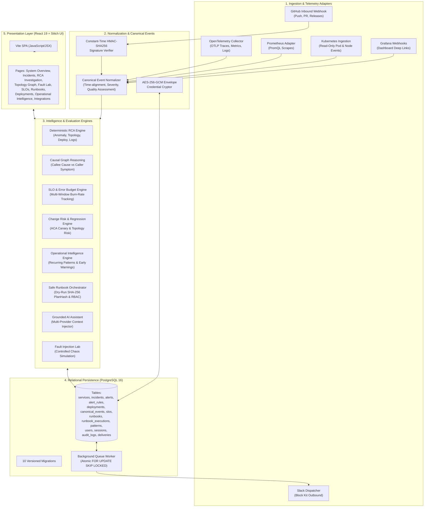
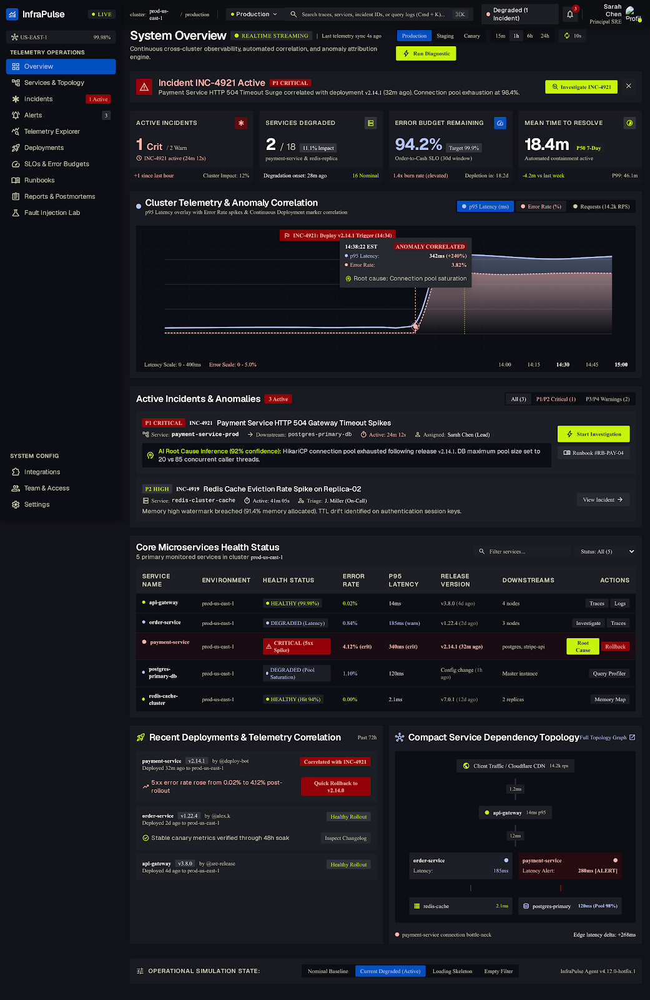
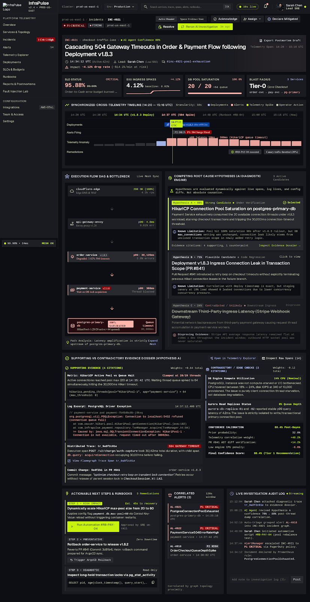
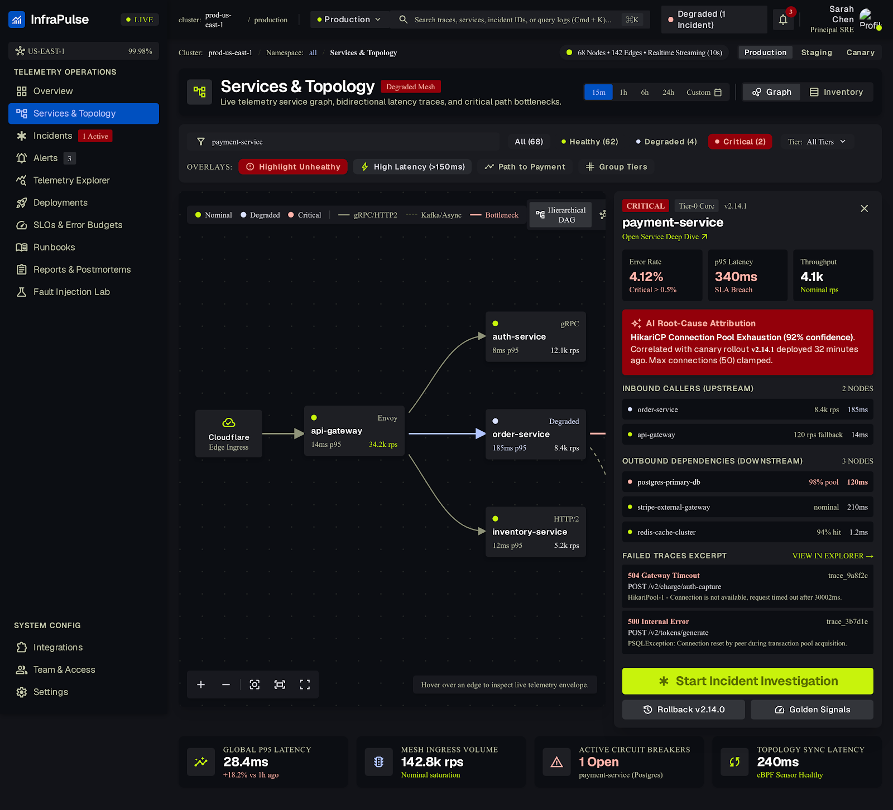
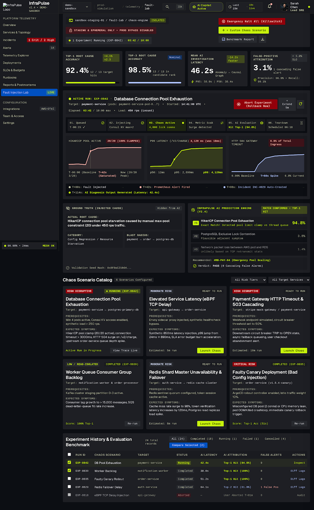
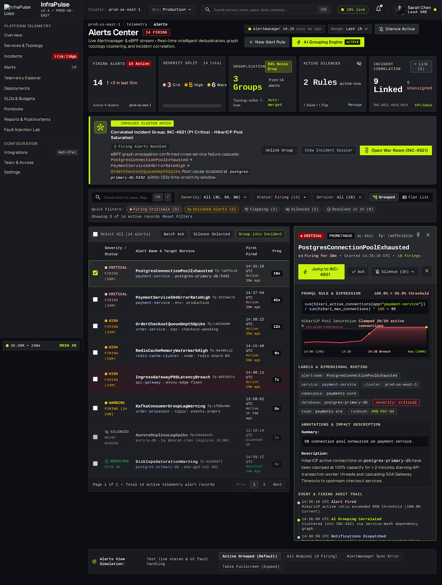
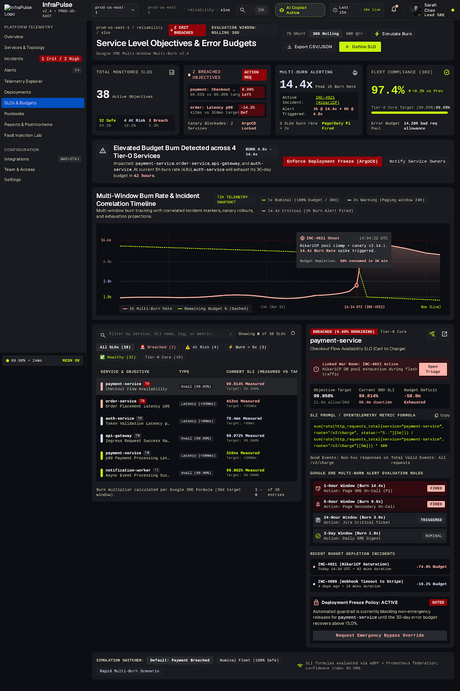
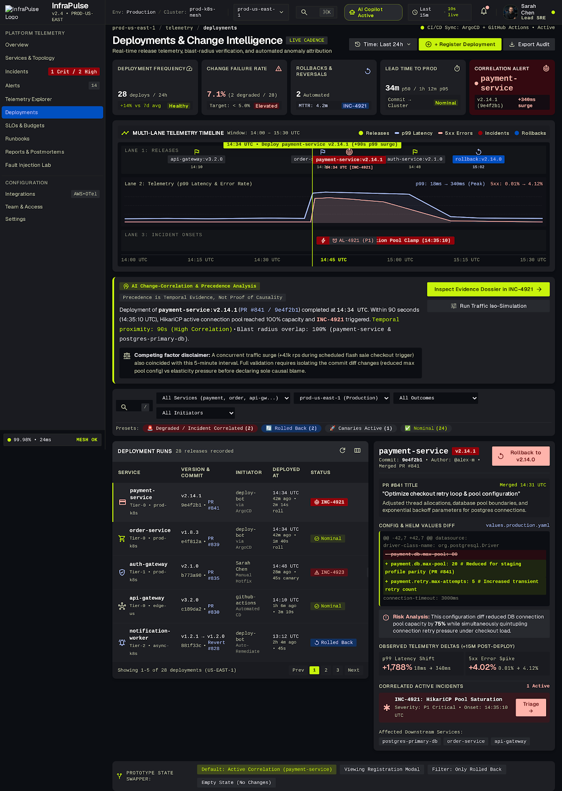
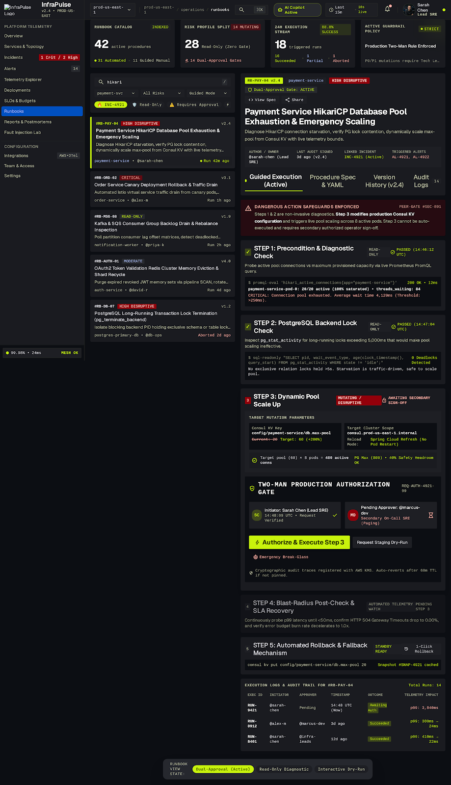
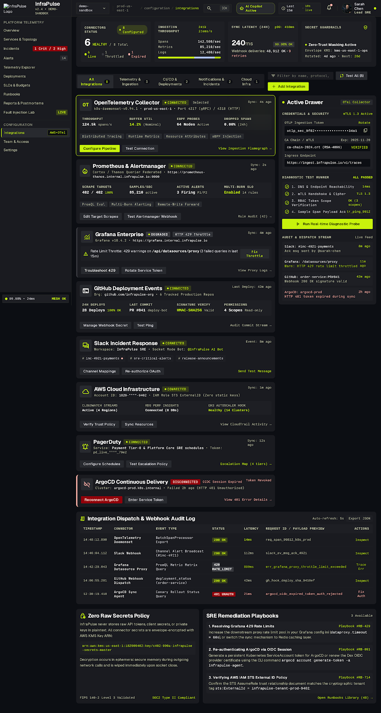

# InfraPulse ⚡

> **Autonomous SRE Observability, Deterministic Root Cause Analysis & Safe Incident Remediation Platform**  
> *Production-ready v1.0 release built with React, Node.js, Express, PostgreSQL, and OpenTelemetry.*

[](docs/RELEASE_NOTES_V1.md)
[](docs/PHASE_30_V1_RELEASE_REPORT.md)
[](docs/SECURITY_ARCHITECTURE.md)
[](LICENSE)

---

## 📋 Table of Contents
1. [Project Overview & Problem Statement](#-project-overview--problem-statement)
2. [Project Status (v1.0.0)](#-project-status-v100)
3. [Key Platform Capabilities](#-key-platform-capabilities)
4. [System Architecture](#-system-architecture)
5. [Platform Subsystems Deep-Dive](#-platform-subsystems-deep-dive)
   - [Deterministic RCA & Causal Graph Engine](#1-deterministic-rca--causal-graph-engine)
   - [Fault Injection Lab & Blast Radius Analysis](#2-fault-injection-lab--blast-radius-analysis)
   - [Observability, Telemetry & Canonical Event Normalization](#3-observability-telemetry--canonical-event-normalization)
   - [Grounded AI Investigation Assistant](#4-grounded-ai-investigation-assistant)
   - [Safe Runbook Orchestration & Two-Party Approval Governance](#5-safe-runbook-orchestration--two-party-approval-governance)
   - [SLO-Driven Reliability & Multi-Window Burn-Rate Tracking](#6-slo-driven-reliability--multi-window-burn-rate-tracking)
   - [Deployment Risk & Change Intelligence](#7-deployment-risk--change-intelligence)
   - [Operational Intelligence & Preventive Recommendations](#8-operational-intelligence--preventive-recommendations)
   - [Enterprise Integrations Ecosystem & Credential Security](#9-enterprise-integrations-ecosystem--credential-security)
6. [Authentic UI Showcase](#-authentic-ui-showcase)
7. [Technology Stack](#-technology-stack)
8. [Local Installation & Setup Guide](#-local-installation--setup-guide)
9. [Database Migrations & Relational Schema](#-database-migrations--relational-schema)
10. [Package Scripts Reference](#-package-scripts-reference)
11. [REST API Documentation](#-rest-api-documentation)
12. [Environment Configuration Reference](#-environment-configuration-reference)
13. [Security, Governance & Known Limitations](#-security-governance--known-limitations)

---

## 🌟 Project Overview & Problem Statement

Modern microservices-based distributed architectures are extraordinarily complex. During production outages, site reliability engineers (SREs) face distinct challenges:
- **Alert Fatigue & Noise**: Cascading downstream service timeouts trigger hundreds of repetitive alerts that obscure the single underlying fault.
- **Siloed Telemetry**: Metrics, distributed trace waterfalls, container logs, deployment events, and change tickets live in disconnected consoles, requiring slow manual cross-correlation.
- **Hallucination-Prone AI Assistants**: Generic LLMs hallucinate non-existent database errors or fabricate services, misleading responders during high-stress incidents.
- **High-Risk Uncontrolled Remediation**: Automated recovery scripts run without human validation, dry-run previews, or separation of duties, risking secondary catastrophic outages.

**InfraPulse** is built to solve these fundamental operational problems. It unites **time-aligned canonical telemetry correlation**, a **deterministic mathematical root-cause scoring engine**, an **evidence-grounded AI assistant**, and a **safe human-approved runbook orchestration framework** into a single cohesive platform.

---

## 📊 Project Status (v1.0.0)

InfraPulse has completed comprehensive production validation and reliability hardening across 30 engineering phases.

- **Automated Quality Gates**: **337 passing test suites (0 failures)** across backend core, security regression, self-monitoring, disaster recovery, and cloud lifecycle governance.
- **RCA Engine Benchmark**: **85.7% Top-1 accuracy**, **100% Top-3 accuracy**, and **0.929 Mean Reciprocal Rank (MRR)** with a **2.85 ms** average execution latency (9,143 evaluations/second direct throughput).
- **Security & Multi-Tenancy**: PostgreSQL Row-Level Security (`NOBYPASSRLS`), timing attack mitigation on authentication, strict separation of duties, and zero static secrets.
- **Disaster Recovery**: All 22 database migrations verified on PostgreSQL 16 (2.55s), with automated backup and point-in-time recovery runbooks.
- **Deployment Scope**: Fully validated for local workstation, bare-metal, and self-hosted container deployments (`deploy/production/compose.yml`). Cloud deployment to AWS `ap-south-1` is fully documented and gated behind explicit user budget approval.

For detailed test matrices, performance benchmarks, and evaluation datasets, see:
- [`RELEASE_NOTES_V1.md`](docs/RELEASE_NOTES_V1.md)
- [`PHASE_29_PRODUCTION_VALIDATION_REPORT.md`](docs/PHASE_29_PRODUCTION_VALIDATION_REPORT.md)
- [`PHASE_30_V1_RELEASE_REPORT.md`](docs/PHASE_30_V1_RELEASE_REPORT.md)
- [`DEMO_AND_ONBOARDING_GUIDE.md`](docs/DEMO_AND_ONBOARDING_GUIDE.md)

---

## ✨ Key Platform Capabilities

- **Deterministic Root Cause Analysis (RCA)**: Computes explainable confidence scores for candidate root causes based on anomaly severity (30%), temporal deployment correlation (25%), causal topology position (25%), and log/trace error evidence (20%), with statistical baseline deviation and anti-double-counting signal adjustments.
- **Controlled Fault Injection Lab**: Safely injects chaos scenarios (latency surges, error cascades, database connection pool exhaustion, CPU saturation) with real-time blast-radius calculation and automated rollback.
- **Evidence-Grounded AI Assistant**: Integrates multi-provider AI reasoning (OpenAI, Google Gemini, or local deterministic mock) constrained by verified runtime telemetry context, strictly preventing hallucinated recommendations.
- **Two-Party Human-Governed Runbooks**: Enforces deterministic SHA-256 `planHash` dry-runs, two-party approval separation of duties (requesters cannot approve their own remediation), and non-destructive simulated execution adapters.
- **SLO & Error Budget Intelligence**: Tracks fast (1h, 6h) and slow (24h, 30d) error-budget burn rates against Service Level Objectives (SLOs), providing early warning breach risk indicators.
- **Deployment Risk & Change Correlation**: Correlates git commits, PR sizes, author deployment frequencies, and historical service failure rates to score pre-release risk and identify post-release regressions.
- **Predictive Operational Intelligence**: Detects recurring failure patterns (minimum 2 verified historical incidents) and produces structured, prioritized engineering recommendations to prevent recurring outages.
- **Enterprise Integrations Ecosystem**: Connects GitHub, Kubernetes, Prometheus, Grafana, Slack, and OpenTelemetry with authenticated AES-256-GCM envelope encryption at rest and constant-time HMAC-SHA256 signature verification.

---

## 🏛 System Architecture

The following Mermaid diagram illustrates the end-to-end data flow, processing pipeline, and subsystem relationships in InfraPulse:



---

## 🔍 Platform Subsystems Deep-Dive

### 1. Deterministic RCA & Causal Graph Engine
The root cause analysis engine (`backend/src/engine/rcaEngine.js`) avoids probabilistic guesswork. When an incident occurs, candidate services are evaluated deterministically across four evidence dimensions:
- **Anomaly Severity (30%)**: Statistical deviation of P99 latency, error rates, and CPU/memory saturation against historical baselines (`anomalyDetector.js`).
- **Deployment Correlation (25%)**: Temporal proximity of recent deployments, author release history, commit churn, and Automated Canary Analysis (ACA) scores (`scoring.js`).
- **Causal Topology (25%)**: Dependency graph traversal disambiguating upstream root causes (callees) from downstream cascading timeout victims (callers) (`causalGraph.js`).
- **Log & Trace Evidence (20%)**: Error log density, database connection timeout signatures, and OTLP waterfall trace errors.
- **Anti-Double-Counting**: When both active alerts and OTel spans confirm the same failure, trace weights are normalized by `0.85x` to prevent artificially inflated scores.

### 2. Fault Injection Lab & Blast Radius Analysis
The Chaos Engineering subsystem (`backend/src/engine/faultSimulator.js`) allows operators to validate system resilience before outages occur:
- **Supported Failure Modes**: Downstream database pool exhaustion, cascading service latency (500ms–2000ms surges), randomized 5xx error injection, and memory leaks.
- **Blast Radius Computation**: Traverses downstream service dependencies, computing impact severity, estimated financial cost per minute, and expected SLO burn rates.
- **Safety Policy**: All chaos actions execute against simulated adapters by default; real mutations are strictly blocked unless production credentials and override flags are explicitly configured.

### 3. Observability, Telemetry & Canonical Event Normalization
InfraPulse supports dual-mode observability (`backend/src/integrations/telemetry/`):
- **Demo Mode**: Generates a self-consistent synthetic microservice mesh (`api-gateway`, `orders-service`, `payments-service`) with nominal baselines and injected anomalies.
- **Live Mode**: Scrapes real telemetry via Prometheus endpoints, Grafana Tempo trace endpoints, Loki log endpoints, and an unprivileged OTel Collector listening on ports `4317`/`4318`.
- **Event Normalization**: All telemetry signals, deployments, and alerts are normalized into a unified schema (`canonicalEvents.js`) tagged with an evidence quality rating (`good`, `incomplete`, `stale`, `missing`).

### 4. Grounded AI Investigation Assistant
The AI Assistant (`backend/src/services/aiInvestigation.service.js`) helps operators triage incidents without hallucinating:
- **Grounded Context Catalog**: Queries live topology, active alerts, RCA ranked hypotheses, and recent deployments, assembling a structured, tamper-proof system prompt.
- **Multi-Provider Factory**: Pluggable provider architecture supporting OpenAI, Google Gemini, or the built-in deterministic Mock Provider.
- **Anti-Hallucination Guardrails**: Prompts strictly instruct the model to answer only using verified catalog evidence and to flag missing or contradictory data explicitly.

### 5. Safe Runbook Orchestration & Two-Party Approval Governance
The remediation framework (`backend/src/services/runbookExecution.service.js`) prevents automated runbooks from causing secondary outages:
- **Deterministic Dry-Run Plan**: Generates an execution plan and computes a 64-character SHA-256 `planHash` capturing the exact target service, parameters, and step sequence.
- **Two-Party Approval Policy**: High-risk remediation procedures (e.g. rollbacks, service restarts) require explicit approval from an Admin or Responder role. Requesters are cryptographically prevented from approving their own remediation requests (separation of duties).
- **Execution History & Compensation**: Tracks step-level outcomes (`succeeded`, `failed`), timestamps, and compensating rollback actions.

### 6. SLO-Driven Reliability & Multi-Window Burn-Rate Tracking
The reliability engine (`backend/src/engine/sloEngine.js`) implements Google SRE multi-window burn-rate tracking:
- **Multi-Window Evaluation**: Computes consumption rates across short-term fast-burn windows (1-hour, 6-hour) and long-term slow-burn windows (24-hour, 30-day).
- **Error Budget Analytics**: Calculates remaining error budget percentages, allowed bad events, and estimated time until complete budget exhaustion.
- **Automated Alerts**: Generates breach risk notifications when 1-hour burn rates exceed 14.4x (consuming 2% of budget) or 6-hour rates exceed 6x (consuming 5% of budget).

### 7. Deployment Risk & Change Intelligence
The change intelligence engine (`backend/src/engine/changeRiskEngine.js`) protects production reliability:
- **Pre-Deployment Risk Matrix**: Evaluates PR lines changed, number of affected dependencies, deployment time (e.g. Friday deployments vs off-peak), and historical service failure rate.
- **Regression Detection**: Analyzes post-deployment telemetry windows (15m, 1h, 24h) to identify latency drift or error rate elevation compared to pre-deployment baselines.

### 8. Operational Intelligence & Preventive Recommendations
The operational intelligence engine (`backend/src/engine/failurePatternEngine.js`) transforms historical incident records into proactive reliability improvements:
- **Recurring Pattern Detection**: Analyzes incidents, RCA hypotheses, and deployment regressions across a sliding 90-day window. Only failure signatures observed **2 or more times** are flagged as recurring patterns.
- **Evidence-Backed Recommendations**: Proposes concrete engineering actions (e.g. scaling database connection pool sizes, introducing local token fallback caches, tuning circuit breakers) linked directly to supporting incident IDs.

### 9. Enterprise Integrations Ecosystem & Credential Security
The integration layer (`backend/src/integrations/core/`) connects InfraPulse into existing enterprise workflows:
- **AES-256-GCM Envelope Encryption**: Credentials (API tokens, webhook secrets) are encrypted with 96-bit random IVs and 128-bit authentication tags before persistence in PostgreSQL.
- **Constant-Time HMAC-SHA256**: Inbound webhooks from GitHub and Grafana are validated using constant-time comparison (`crypto.timingSafeEqual`) to prevent timing side-channel attacks.
- **Read-Only Guarantees**: The Kubernetes provider enforces read-only inspection of pods and node status; zero mutation endpoints are implemented.

---

## 🖼 Authentic UI Showcase

The user interface is built according to the **Stitch Design System** featuring high-contrast Midnight Black (`#030407`), Electric Cobalt Blue (`#1558C9`), and Acid Lime (`#D4FF24`):

| Page | Authentic Screenshot | Description |
|---|---|---|
| **System Overview** |  | Unified health matrix, multi-service latency graphs, active alerts count, and quick triage actions. |
| **Incident Investigation & RCA** |  | Ranked root-cause hypotheses, causal role attribution, supporting evidence lists, and AI Assistant panel. |
| **Services Topology Mesh** |  | Interactive dependency graph highlighting critical paths, degraded nodes, and cascading latency propagation. |
| **Fault Injection Lab** |  | Chaos simulation cockpit with blast radius previews, parameter controls, and real-time rollback. |
| **Alerts Center** |  | Intelligent alert rule management, deduplication status, severity filters, and one-click incident escalation. |
| **SLOs & Error Budgets** |  | Multi-window burn-rate dials, remaining error budget margins, and service reliability scorecards. |
| **Deployments & Changes** |  | Deployment timeline, automated canary analysis (ACA) scores, change risk matrix, and regression markers. |
| **Safe Runbooks** |  | Runbook catalog, dry-run SHA-256 plan hash verification, approval requests, and audit history. |
| **Enterprise Integrations** |  | Status cards for GitHub, Kubernetes, Prometheus, Grafana, Slack, and OTel with credential rotation. |

---

## 🛠 Technology Stack

| Layer | Technologies |
|---|---|
| **Frontend** | React 19, Vite v6, Tailwind CSS, Lucide React, Recharts, React Flow (Topology) |
| **Backend API** | Node.js v20 LTS, Express v4, Pure JavaScript ES Modules (`.js`) |
| **Database & Persistence** | PostgreSQL 16, Versioned SQL Migrations, `pg` connection pool |
| **Background Processing** | Dedicated Node.js Queue Worker (`worker.js`) with atomic row claiming (`FOR UPDATE SKIP LOCKED`) |
| **Security & Auth** | HTTP-Only Session Cookies, exact-origin CSRF checks, Bcrypt Hashing, AES-256-GCM, Constant-Time HMAC-SHA256 |
| **Telemetry & Observability** | OpenTelemetry SDK (OTLP HTTP), Prometheus (PromQL), Grafana Tempo, Grafana Loki |
| **Containerization** | Docker, Multi-Stage Alpine Dockerfiles, Unprivileged Nginx, Docker Compose |
| **Testing** | Node.js Native Test Runner (`node --test`), Assert/Strict, Cross-Suite Concurrency Control |

---

## 🚀 Local Installation & Setup Guide

### 1. System Prerequisites
- **Node.js**: v18.0.0 or higher (v20+ recommended).
- **npm**: v9.0.0 or higher.
- **PostgreSQL**: v14+ (Local service running on port `5434` or `5432`, or Docker container).

### 2. Clone Repository & Install Dependencies
```bash
git clone https://github.com/KartikMandake/InfraPulse.git
cd InfraPulse

# Install root, backend, frontend, and demo-services dependencies
npm run install:all
```

### 3. Configure Environment Variables
Copy the provided `.env.example` templates:
```powershell
# Windows PowerShell
Copy-Item backend\.env.example backend\.env
Copy-Item .env.example .env

# macOS / Linux
cp backend/.env.example backend/.env
cp .env.example .env
```
Edit `backend/.env` to point to your local PostgreSQL database (e.g. `PGHOST=localhost`, `PGPORT=5434`, `PGUSER=postgres`, `PGPASSWORD=postgres`).

### 4. Apply Database Migrations & Seed Data
```bash
# Run 22 versioned SQL migrations
npm run db:migrate

# Idempotently seed baseline services, incidents, alerts, SLOs, and users
npm run db:seed
```

### 5. Start the Application
Run frontend and backend simultaneously in development mode:
```bash
npm run dev
```
- **Web Interface**: `http://localhost:5173`
- **Backend API**: `http://localhost:5000`

---

## 🗄 Database Migrations & Relational Schema

InfraPulse maintains strict forward-compatible relational persistence through **22 versioned SQL migrations** in `backend/src/db/migrations/`:

| Migration | Subsystem | Description |
|---|---|---|
| `001_initial_schema.sql` | Core Platform | Core services, incidents, incident milestone events, alert rules, and alerts tables. |
| `002_auth_rbac_audit.sql` | Identity & Governance | Users, persistent session storage, and comprehensive security audit logs. |
| `003_notifications.sql` | Delivery Dispatcher | Notification channels, delivery queue, attempt counters, and retry backoff records. |
| `004_ai_assistant.sql` | Grounded AI | AI investigation conversations, message history, evidence references, and token usage. |
| `005_runbook_orchestration.sql` | Safe Remediation | Runbooks catalog, execution plans, two-party approval requests, and step action logs. |
| `006_slo_reliability.sql` | SLO & Error Budgets | Service Level Objectives, SLI targets, multi-window burn rate snapshots, and breach alerts. |
| `007_change_intelligence.sql` | Change Risk | Deployment records, version changes, change risk matrices, and post-release regressions. |
| `008_unified_correlation.sql` | Observability Correlation | Canonical normalized events, cross-source correlations, and investigation graph snapshots. |
| `009_operational_intelligence.sql` | Predictive Intelligence | Recurring failure patterns, service risk profiles, early warnings, and preventive recommendations. |
| `010_integrations_ecosystem.sql` | Enterprise Ecosystem | Provider registrations, AES-256-GCM encrypted credentials, webhook deliveries, and audit events. |
| `011_cloud_lifecycle_cost_governance.sql` | Cloud governance | Resources, approval operations, schedules and cost estimates. |
| `012_aws_discovery_governance.sql` | AWS discovery | Read-only discovery and eligibility metadata. |
| `013_infrastructure_drift_governance.sql` | Drift | Baselines, snapshots, deviations and reconciliation previews. |
| `014_real_infrastructure_integrations.sql` | Provider metadata | Inventory and provider capabilities. |
| `015_telemetry_reliability_and_incident_intelligence.sql` | Telemetry | Dead letters, observed dependencies and ingestion statistics. |
| `016_governed_remediation_intelligence.sql` | Remediation | Recommendations, canonical plans, approvals and executions. |
| `017_autonomous_sre_intelligence.sql` | SRE | Health, forecasts, SLO histories and capacity estimates. |
| `018_enterprise_hardening_indexes.sql` | Indexes | Query performance indexes. |
| `019_tenant_security_and_durable_governance.sql` | Security | Tenant ownership/RLS, durable deduplication, emergency state and immutable plans. |
| `020_measurement_evidence.sql` | Measurement | Environment-scoped event identity and window evidence. |
| `021_unknown_burn_history.sql` | Measurement | Nullable history values for unobserved windows. |
| `022_cross_workflow_resource_exclusion.sql` | Governance | Database exclusion across lifecycle/remediation execution claims. |

---

## 📜 Package Scripts Reference

Available package scripts are listed below. Validation scope and unexecuted infrastructure cases are disclosed in the Phase 23M report:

```bash
# Development & Execution
npm run install:all     # Cleanly install root, backend, frontend, and demo-services dependencies
npm run dev             # Concurrently launch backend (port 5000) and frontend (port 5173)
npm run dev:backend     # Launch backend API in development watch mode
npm run dev:frontend    # Launch frontend Vite dev server
npm run start:backend   # Start backend API; set NODE_ENV=production explicitly for production configuration
npm run start:worker    # Start standalone background notification queue worker
npm run start:demo      # Start the local microservice demo mesh (ports 4001, 4002, 4003)

# Database Management
npm run db:migrate      # Execute all pending PostgreSQL migrations in order
npm run db:seed         # Idempotently seed database with demo services, incidents, and accounts

# Production Build
npm run build           # Full production build (compiles frontend Vite bundle)
npm run build:frontend  # Compile frontend into frontend/dist/ directory

# Verification (use disposable test databases)
npm test                # Root aggregate includes infrastructure cases: review flags and isolate its database first
npm run test:backend    # Execute core backend persistence, auth, RBAC, and alert tests
npm run test:rca        # Execute RCA engine and holdout scenario benchmarks
npm run test:assistant  # Test grounded AI assistant and anti-hallucination guardrails
npm run test:remediation# Test safe runbook orchestration and two-party approval governance
npm run test:slo        # Test SLO evaluation and multi-window burn-rate tracking
npm run test:changes    # Test change risk scoring and regression detection
npm run test:correlation# Test canonical event normalization and cross-source correlation
npm run test:operations # Test recurring pattern detection and preventive recommendations
npm run test:integrations# Test enterprise integration adapters, encryption, and webhooks
npm run test:e2e        # Execute full 15-step end-to-end operational lifecycle validation
npm run test:failure    # Execute 20-scenario failure, chaos, and recovery validation
npm run benchmark       # Run performance benchmark suite (ingestion, RCA, alert load)
```

---

## 📡 REST API Documentation

InfraPulse exposes a clean, consistent REST API responding with standard JSON envelopes:

### Core Endpoints Overview
| Method | Route | Description | Minimum access |
|---|---|---|---|
| GET | `/api/health/live`, `/api/health/ready` | Liveness and database readiness | Public |
| POST | `/api/auth/register`, `/api/auth/login` | Server-owned tenant membership and session creation | Public |
| GET | `/api/services`, `/api/incidents`, `/api/alerts`, `/api/deployments` | Tenant-owned records | Authenticated |
| GET | `/api/incidents/:incidentId/investigation` | Ranked evidence-qualified hypotheses | Authenticated |
| POST | `/api/incidents/:incidentId/investigation/run` | Refresh investigation | Responder/admin |
| POST | `/api/incidents/:incidentId/assistant/chat` | Grounded assistant conversation | Authenticated |
| PATCH | `/api/alerts/:alertId/acknowledge`, `/api/alerts/:alertId/resolve` | Alert state update | Responder/admin |
| GET | `/api/slos` | Service objectives | Authenticated |
| POST | `/api/slos/:sloId/evaluate` | Evaluate timestamped SLI observations | Responder/admin |
| POST | `/api/fault-lab/simulations` | Explicit synthetic fault simulation | Responder/admin |
| GET | `/api/operations/intelligence/overview` | Operational intelligence | Authenticated |
| POST | `/api/integrations/otlp/v1/metrics`, `/traces`, `/logs` | Credential-bound OTLP JSON ingestion | Enabled integration ingestion key |
| GET | `/api/health/diagnostics` | Detailed diagnostics | Authenticated |


---

## ⚙️ Environment Configuration Reference

| Variable | Default | Purpose |
|---|---|---|
| `NODE_ENV` | `development` | Runtime environment mode (`development`, `production`, `test`). |
| `PORT` | `5000` | Backend API HTTP port. |
| `FRONTEND_URL` | `http://localhost:5173` | Allowed CORS origin for web browser clients. |
| `APP_BASE_URL` | `http://localhost:5173` | Base URL used when generating deep links in Slack notifications. |
| `PGHOST` | `localhost` | PostgreSQL host. |
| `PGPORT` | `5434` / `5432` | PostgreSQL listening port. |
| `PGDATABASE` | `infrapulse` | Production database name. |
| `PGDATABASE_TEST`| `infrapulse_test` | Isolated test database name. |
| `PGUSER` | `postgres` | PostgreSQL username. |
| `PGPASSWORD` | `postgres` | PostgreSQL password. |
| `NOTIFICATION_WORKER_ENABLED` | `true` | Runs queue worker inside the API process (set `false` for standalone worker). |
| `NOTIFICATION_MOCK_MODE` | `true` | Simulates delivery in-memory without outbound network calls. |
| `INTEGRATION_ENCRYPTION_KEY` | Development key | 32-byte secret key for authenticated AES-256-GCM credential encryption. |
| `AI_PROVIDER` | `mock` | Active AI provider (`mock`, `openai`, `gemini`). |
| `OPENAI_API_KEY` | None | API key for OpenAI provider (optional). |
| `GEMINI_API_KEY` | None | API key for Google Gemini provider (optional). |
| `SLACK_WEBHOOK_URL` | None | Slack incoming webhook URL for notifications. |
| `SMTP_HOST` | None | SMTP relay server for email alerts. |

---

## 🔒 Security, Governance & Known Limitations

### Security Architecture
- **Authenticated Encryption at Rest**: Integration secrets are encrypted via AES-256-GCM. Ciphertext tampering throws authentication tag verification errors.
- **Constant-Time Cryptography**: Webhook HMAC signatures are compared using `crypto.timingSafeEqual` to eliminate timing attacks.
- **Deep Log Redaction**: Request logging middleware automatically strips bearer tokens, passwords, Slack webhooks, and SMTP secrets.
- **Cross-Site Request Forgery (CSRF)**: Cookie-authenticated mutations require an exactly trusted Origin/Referer. Integration ingestion uses dedicated verified credentials or signatures.
- **Separation of Duties**: Requesters are blocked from approving their own remediation executions. High-risk runbooks require two-party authorization.

### Known Limitations & Operational Considerations
1. **Container Daemon Status**: Deployment manifests were inspected. Running container/Kubernetes deployment, live mutation and failover remain unverified. Local native startup uses `npm run dev`.
2. **Third-Party Live Connectors**: External providers require explicit credentials and connectivity. Failed or disabled integrations return errors; authenticated tenant requests do not receive demo data as a substitute. Explicit simulation views remain labelled as simulations.
3. **Simulation Safety Policy**: Fault injection and automated remediation actions operate through simulated adapters by default to prevent accidental infrastructure damage. Real infrastructure mutation adapters require dedicated cloud credentials and explicit configuration.

---

## 📄 License
InfraPulse is open-source software licensed under the **[MIT License](LICENSE)**.

## Production deployment preparation

Phase 24 prepares configuration and runbooks; **production deployment is NO-GO**. Nineteen Phase 23N findings, including five P0 lifecycle defects, remain open. Start with the [Phase 24 report](docs/PHASE_24_DEPLOYMENT_PREPARATION_REPORT.md), [production architecture](docs/PRODUCTION_DEPLOYMENT_ARCHITECTURE.md) and [gated deployment runbook](docs/PRODUCTION_DEPLOYMENT_RUNBOOK.md). The root Compose stack is a development/demo environment. The separate production draft is `deploy/production/compose.yml`; it has not been run in Docker. AWS cost estimates do not establish a ₹0 deployment.

## CI and release automation

Phase 25 adds lockfile-based CI, an explicit safe test profile, pinned action/tool/base-image references, build-only image scanning, checksummed unpublished candidates, and protected plan-only staging/production/rollback workflows. **Deployment and publication remain disabled.** GitHub execution and environment settings have not been verified. Start with the [Phase 25 report](docs/PHASE_25_CICD_RELEASE_AUTOMATION_REPORT.md), [CI architecture](docs/CICD_ARCHITECTURE.md) and [pipeline runbook](docs/DEPLOYMENT_PIPELINE_RUNBOOK.md).

`npm run release:check`, `npm run ci:policy` and `npm run test:cicd` validate local release/pipeline rules. `npm run ci:test` additionally requires an explicitly selected disposable loopback `infrapulse_ci_*` database; never point it at existing user data. Legacy `npm test` is not the safe CI profile because some fixtures enable execution flags. Existing tests are retained; exclusions and five live-provider skips are recorded explicitly.

## Phase 23M migration and operation notes

Apply migrations only to an explicitly selected database, using a migration identity allowed to create/alter roles and table policies. Migration 019 creates or hardens the NOLOGIN/NOBYPASSRLS `infrapulse_tenant_runtime` role. Authenticated request queries use transaction-local tenant identity and that restricted role, including when the connection owner is a superuser. Existing rows retain their historical `default_tenant` ownership; new signup membership is generated by the server. Existing approved legacy plans are revoked and require a newly generated canonical plan and approval. Migration stops on conflicting active resource claims; operators must reconcile them before retrying. Do not delete historical execution records to force migration success.

Keep `AWS_LIFECYCLE_MUTATIONS_ENABLED`, `DOCKER_LIFECYCLE_ENABLED`, `KUBERNETES_LIFECYCLE_ENABLED`, `REMEDIATION_EXECUTION_ENABLED` and `REMEDIATION_PRODUCTION_ENABLED` false during validation. The emergency freeze is durable and shared across processes and fails closed if its database state cannot be read. It prevents new guarded mutations; it cannot cancel a provider request already sent.

OTLP keys belong to one enabled integration and its tenant/environment. Use `Authorization: Bearer <ingestion-key>` or `x-otlp-key`. Rotating the credential immediately invalidates the old key. The implemented parser accepts supported OTLP JSON gauge/sum metrics, traces and logs; unsupported histogram payloads return a client error. Use actual timestamped window evidence for burn rates. Trace-derived counts are sampled observations and cannot establish complete request coverage. Cost/savings fields are estimates.

`npm run start:frontend` starts Vite on 5173; `npm run dev` starts backend/frontend using configured environment values. `npm test --prefix frontend` builds and checks feedback behavior and the per-chunk size budget. Passing that budget does not measure Web Vitals. See [recovery documentation](docs/ENTERPRISE_PRODUCTION_HARDENING.md) for logical backup/restore and the unverified archival-PITR boundary.
