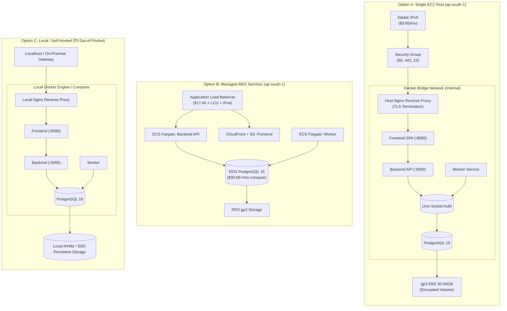

# InfraPulse — AWS Deployment Architecture Specification

**Platform**: InfraPulse v2.4.0  
**Phase**: Phase 28 — Controlled Cloud Deployment  
**Target Region**: `ap-south-1` (AWS Asia Pacific - Mumbai)  
**FinOps Budget Constraint**: Strict Out-of-Pocket Limit of ₹0  
**Status**: DESIGN COMPLETE — DEPLOYMENT HALTED AT APPROVAL GATE  

---

## 1. Executive Summary & Architectural Scope

This specification defines the cloud deployment architecture for InfraPulse in AWS region `ap-south-1` (Mumbai). The deployment scope encompasses the complete platform topology:
- **Frontend**: React 18 + Vite SPA served via unprivileged Nginx.
- **Backend API**: Node.js 24 + Express REST API with distributed tracing, RBAC, and tenant isolation.
- **Background Worker**: Asynchronous notification dispatcher and telemetry batch processor.
- **Database**: PostgreSQL 16 relational database with Row-Level Security (RLS) and encrypted persistent storage.
- **Observability Stack**: Prometheus metrics scraper, Grafana dashboards, Loki log aggregation, Tempo distributed tracing, and OpenTelemetry collector.
- **Cloud Lifecycle & Incident Intelligence**: Read-only AWS discovery, multi-cloud inventory, RCA engine, and governed remediation intelligence.

In accordance with Phase 28 financial governance directives, three architectural deployment models were evaluated against financial, operational, and security criteria.

---

## 2. Architecture Options Comparison

---

### Detailed Comparison Matrix

| Evaluation Dimension | Option A: EC2 Single Host | Option B: Managed Cloud Services | Option C: Local / Self-Hosted Fallback |
| :--- | :--- | :--- | :--- |
| **Compute Architecture** | Single `t4g.small` (ARM64) or `t3.small` (x86) | AWS ECS Fargate tasks (API: 0.5 vCPU/1GB; Worker: 0.25 vCPU/0.5GB) | Local workstation or self-hosted bare metal / hypervisor |
| **Database Architecture** | Hardened PostgreSQL 16 container over authenticated Unix socket (`network_mode: none`) | AWS RDS PostgreSQL 16 Single-AZ (`db.t4g.micro` or `db.t4g.small`) | Local containerized PostgreSQL 16 with durable named volume |
| **Ingress & TLS** | Host Nginx reverse proxy + Certbot Let's Encrypt automated TLS | AWS Application Load Balancer + ACM managed public certificate | Local self-signed certificates or Cloudflare Tunnel (free) |
| **Storage & Persistence** | 30–50 GB Amazon EBS `gp3` encrypted volume (`aws/ebs` KMS) | 20–50 GB RDS allocated storage + automated snapshots | Local physical SSD / NVMe directory mount |
| **Monthly Cost (Est.)** | **$30.00 – $45.00** (~₹2,700 – ₹4,050 INR) | **$150.00 – $220.00+** (~₹13,500 – ₹19,800 INR) | **₹0.00 / $0.00** (Zero out-of-pocket spend) |
| **Initial Setup Cost** | $0.00 (Standard AWS setup) | $0.00 (Standard AWS setup) | ₹0.00 (Existing workstation hardware) |
| **Ongoing AWS Charges** | Compute, EBS, IPv4 address ($3.65/mo), data egress | ALB ($25+/mo), Fargate, RDS, NAT Gateway ($32+/mo), ECR, CloudWatch | None |
| **Free Tier Eligibility** | **NOT VERIFIED / NOT ZERO**: Account already uses Free Tier compute and EBS | **NOT ELIGIBLE**: Fargate, ALB, and NAT Gateways have no permanent Free Tier | **100% VERIFIED ZERO-COST**: No external cloud billing |
| **Credit Applicability** | Subject to active promotional credits (none active on account) | Subject to active promotional credits | N/A |
| **Security Posture** | High: Only ports 80/443 public; database completely isolated without TCP | High: Security groups, private subnets, IAM task execution roles | High: Fully behind local firewall / private subnet |
| **Operational Complexity** | Low-to-Moderate: Docker Compose orchestration, automated health checks | High: Complex VPC subnets, route tables, IAM roles, ECS task definitions | Very Low: Single `docker compose up` command |
| **Backup & Recovery** | Automated `scripts/backup-db.ps1` logical dumps + EBS snapshots | AWS automated RDS daily snapshots and point-in-time recovery | Automated local SQL dumps and host snapshots |
| **Limitations & Failure Domains** | Single AZ failure domain; no automatic instance failover | Multi-service complexity; significant cost runaway risk | Dependent on local workstation power and network uptime |

---

## 3. Deep Dive: Option A — EC2-Based Architecture (Design Blueprint)

### 3.1 Network Topology & Isolation
- **VPC**: Default or dedicated VPC in `ap-south-1` (CIDR `172.31.0.0/16` or `10.0.0.0/16`).
- **Subnet**: Single public subnet in `ap-south-1a`.
- **Public Ingress**:
  - Port `443` (HTTPS): Open to `0.0.0.0/0` for production application traffic.
  - Port `80` (HTTP): Open to `0.0.0.0/0` strictly for Let's Encrypt HTTP-01 ACME domain validation and automated 301 redirection to HTTPS.
  - Port `22` (SSH): Strictly restricted to trusted administrator IP CIDR (`<Admin_IP>/32`). SSH passwords disabled; key-pair authentication enforced.
- **Internal Non-Exposed Ports**:
  - Port `5000` (Backend API): Bound strictly to Docker bridge network `application` (`172.x.x.x`). Never published to host network.
  - Port `5432` (PostgreSQL): Bound strictly to Unix domain socket `/var/run/postgresql` with `network_mode: none`. No TCP listener is opened (`listen_addresses=''`).
  - Port `8080` (Frontend): Bound strictly to host loopback interface (`127.0.0.1:8080`).

### 3.2 Compute Sizing & Profile Selection
InfraPulse supports two deployment profiles:
1. **Lightweight Production Profile (`core`)**:
   - Containers: `frontend`, `backend`, `worker`, `postgres`.
   - Host Memory Requirement: 2 GB (e.g., `t4g.small` or `t3.small`).
   - Telemetry Mode: `TELEMETRY_MODE=live` (lightweight ingestion) or `demo`.
   - Working Set RSS: ~650 MB peak memory.
2. **Full Observability Profile (`core` + `telemetry`)**:
   - Colocated Containers: `prometheus`, `grafana`, `loki`, `tempo`, `otel-collector`.
   - Host Memory Requirement: 4 GB – 8 GB (e.g., `t4g.medium` or `t4g.large`).
   - Working Set RSS: ~2.8 GB – 3.6 GB peak memory.

### 3.3 Storage & Persistence Strategy
- **Root Volume**: 20 GB gp3 root disk for OS (Ubuntu 24.04 LTS / Amazon Linux 2023), Docker Engine, and system logs.
- **Data Volume**: 30 GB gp3 persistent volume formatted as `ext4`, mounted to `/var/lib/docker/volumes/postgres-data/_data`.
- **Encryption**: KMS-managed envelope encryption (`aws/ebs` default key) enforced at rest.
- **Volume Lifecycle Invariant**: The PostgreSQL volume is marked `external: true` in `deploy/production/compose.yml`. Rolling updates or rollbacks never delete or reformat the external volume.

---

## 4. Deep Dive: Option B — Managed Service Architecture (Evaluation)

Option B separates each tier into native AWS managed services:
- **Compute**: AWS ECS Fargate running task definitions for `infrapulse-backend` and `infrapulse-worker`.
- **Frontend**: Amazon S3 static website hosting fronted by Amazon CloudFront CDN.
- **Database**: Amazon RDS PostgreSQL 16 Single-AZ (`db.t4g.small` with 20 GB storage).
- **Ingress**: AWS Application Load Balancer (ALB) across two public subnets.
- **Egress Networking**: AWS NAT Gateway ($0.045/hr + $0.045/GB) required to permit private Fargate tasks to reach AWS APIs, external webhooks, and telemetry sources.

### Why Option B is Disqualified for ₹0 Budget
1. **Fixed Baseline Charges**: ALB ($17.45/mo), Fargate vCPU/RAM ($28.40/mo), RDS compute ($30.66/mo), RDS storage ($2.30/mo), NAT Gateway ($32.85/mo), and public IPv4 ($7.30/mo for ALB dual-stack) establish an irreducible baseline of **$118.96/month (~₹10,700 INR)** before any application traffic.
2. **No Free Tier Coverage**: Fargate, ALB, and NAT Gateways have zero Free Tier hours.

---

## 5. Deep Dive: Option C — Local / Self-Hosted Fallback (Recommended)

Option C leverages the exact same container images, database schemas, and configuration invariants as Option A, running on local hardware or an existing server:
- **Zero Cloud Invoiced Spend**: Completely eliminates EC2, EBS, IPv4, and NAT charges.
- **Identical Architecture**: Runs `deploy/production/compose.yml` or `deploy/docker-compose.staging.yml`.
- **100% Security Parity**: Preserves all Phase 27 hardening guarantees (RLS, timing attack mitigation, RBAC, secret redaction, audit logging).
- **Persistent Data Safety**: Retains database state in local Docker volumes backed by host storage.

---

## 6. Architectural Decision & Recommendation

> [!IMPORTANT]
> **FinOps Gate Finding**:
> AWS account `416121583579` has existing infrastructure in `ap-south-1` (`reachify-postgres` on RDS and `reachify-ec2-free-tier` with 20 GB EBS). Free Tier compute and storage allowances are shared at the AWS account level and are already partially consumed. Furthermore, AWS public IPv4 charging policy mandates a non-zero fee of $0.005/hr ($3.65/mo) for any public EC2 instance.
>
> Therefore, **a ₹0 out-of-pocket AWS deployment cannot be verified**.

### Decision:
1. **Halt AWS Provisioning**: In strict compliance with Constraint 2 ("If ₹0 deployment cannot be verified, STOP before provisioning"), no AWS resources will be created.
2. **Execute Option C (Local / Staging)**: Recommend running InfraPulse in the hardened local staging environment for complete validation at zero cost.
3. **Preserve Option A as Approved Blueprint**: If the account owner subsequently approves the estimated $30–$45/month operational budget or applies verified promotional credits, Option A is fully prepared for automated execution.

