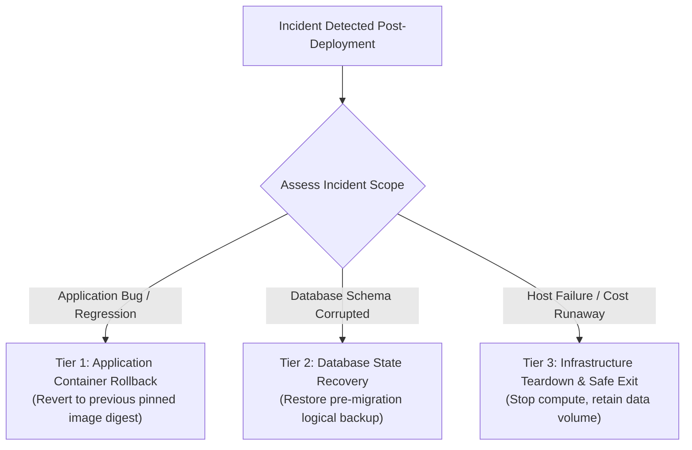

# InfraPulse — AWS Deployment Rollback & Disaster Recovery Runbook

**Platform**: InfraPulse v2.4.0  
**Phase**: Phase 28 — Controlled Cloud Deployment  
**Scope**: Application, Database, and AWS Infrastructure Recovery (`ap-south-1`)  
**Objective**: Guarantee Rapid Rollback and Prevent Persistent Data Loss or Cost Runaway  

---

## 1. Rollback Objectives & Target Metrics

| Metric | Target Objective | Definition |
| :--- | :--- | :--- |
| **Recovery Point Objective (RPO)** | **< 15 minutes** | Maximum acceptable data loss window during a severe incident. |
| **Recovery Time Objective (RTO)** | **< 5 minutes** (App rollback)<br/>**< 30 minutes** (DB restore) | Duration required to return platform to operational healthy state. |
| **Data Preservation Invariant** | **Zero Automated Destruction** | Persistent volumes (`postgres-data`) and backups must never be deleted automatically during rollbacks. |

---

## 2. Multi-Tier Rollback Decision Matrix



---

## 3. Tier 1: Application Container Rollback

Used when a new frontend or backend build introduces application crashes, memory leaks, or unhandled exceptions.

### Procedure (Host SSH):
1. **Identify Previous Pinned SHA-256 Digest**:
   Consult the release manifest in `release/pinned-images.env`:
   ```bash
   PREV_BACKEND_IMAGE="ghcr.io/kartikmandake/infrapulse-backend@sha256:<PREVIOUS_VALIDATED_DIGEST>"
   PREV_FRONTEND_IMAGE="ghcr.io/kartikmandake/infrapulse-frontend@sha256:<PREVIOUS_VALIDATED_DIGEST>"
   ```

2. **Update Environment File**:
   ```bash
   sed -i "s|BACKEND_IMAGE=.*|BACKEND_IMAGE=${PREV_BACKEND_IMAGE}|" /opt/infrapulse/.env.production
   sed -i "s|FRONTEND_IMAGE=.*|FRONTEND_IMAGE=${PREV_FRONTEND_IMAGE}|" /opt/infrapulse/.env.production
   ```

3. **Re-deploy Containers Without Downtime**:
   ```bash
   cd /opt/infrapulse
   docker compose -f deploy/production/compose.yml up -d backend frontend
   ```

4. **Verify Health**:
   ```bash
   docker compose -f deploy/production/compose.yml ps
   curl -fsSL http://127.0.0.1:8080/healthz
   curl -fsSL http://127.0.0.1:5000/api/health/ready
   ```

---

## 4. Tier 2: Database Disaster Recovery

Used when migrations fail halfway or data corruption occurs.

### 4.1 Safety Rule: NEVER Delete Persistent Storage
- `postgres-data` is marked `external: true` in `deploy/production/compose.yml`.
- Running `docker compose down` will stop containers but **will NOT touch the database disk**.
- Never run `docker compose down -v` or `docker volume rm postgres-data-prod`.

### 4.2 Restoring from Pre-Migration Logical Dump
Using the automated restore scripts (`scripts/restore-db.ps1` or `scripts/restore-db.sh`):

```bash
# 1. Stop backend and worker to terminate active connection pools
docker compose -f deploy/production/compose.yml stop backend worker

# 2. Execute restore script against PostgreSQL container
./scripts/restore-db.sh \
  --container infrapulse-postgres \
  --database infrapulse \
  --admin-user migration_admin \
  --backup-file /var/lib/postgresql/data/backup_pre_migration.dump

# 3. Restart application containers
docker compose -f deploy/production/compose.yml start backend worker

# 4. Verify data integrity and API connectivity
curl -fsSL http://127.0.0.1:5000/api/health/ready
```

---

## 5. Tier 3: Complete Infrastructure Teardown & Cost Elimination

Used if deployment authorization is revoked, budget limits are approached, or the platform must be decommissioned.

> [!IMPORTANT]
> **Order of Operations**:
> Public IPv4 addresses incur charges whether attached or unattached. Always release Elastic IPs immediately after instance termination.

### Step-by-Step Cleanup Procedure:

1. **Take Final Persistent Snapshot of EBS Volume**:
   ```bash
   SNAPSHOT_ID=$(aws ec2 create-snapshot \
     --volume-id "$VOL_ID" \
     --description "Final pre-teardown snapshot of InfraPulse postgres-data" \
     --tag-specifications 'ResourceType=snapshot,Tags=[{Key=Project,Value=InfraPulse},{Key=Retain,Value=True}]' \
     --region ap-south-1 \
     --query 'SnapshotId' --output text)
   echo "Preserved persistent data in snapshot: $SNAPSHOT_ID"
   ```

2. **Terminate EC2 Instance**:
   ```bash
   aws ec2 terminate-instances --instance-ids "$INSTANCE_ID" --region ap-south-1
   aws ec2 wait instance-terminated --instance-ids "$INSTANCE_ID" --region ap-south-1
   ```

3. **Detach and Delete Unattached EBS Volumes** (once confirmed snapshot is active):
   ```bash
   aws ec2 wait snapshot-completed --snapshot-ids "$SNAPSHOT_ID" --region ap-south-1
   aws ec2 delete-volume --volume-id "$VOL_ID" --region ap-south-1
   ```

4. **Release Elastic IP to Prevent Unattached IPv4 Charges**:
   ```bash
   aws ec2 release-address --allocation-id "$ALLOC_ID" --region ap-south-1
   ```

5. **Delete Security Group**:
   ```bash
   aws ec2 delete-security-group --group-id "$SG_ID" --region ap-south-1
   ```

6. **Verify Zero Active InfraPulse Resources in ap-south-1**:
   ```bash
   aws ec2 describe-instances --region ap-south-1 --filters "Name=tag:Project,Values=InfraPulse"
   aws ec2 describe-volumes --region ap-south-1 --filters "Name=tag:Project,Values=InfraPulse"
   aws ec2 describe-addresses --region ap-south-1 --filters "Name=tag:Project,Values=InfraPulse"
   ```

---

## 6. Verification and FinOps Audit

After executing Tier 3 teardown:
- Confirm that no `InfraPulse` tagged EC2, EBS, or EIP resources remain in `ap-south-1`.
- Verify that existing third-party resources (such as `reachify-postgres` and `reachify-ec2-free-tier`) remain completely untouched.
- Verify invoice projections to confirm zero recurring charges from the terminated deployment.

