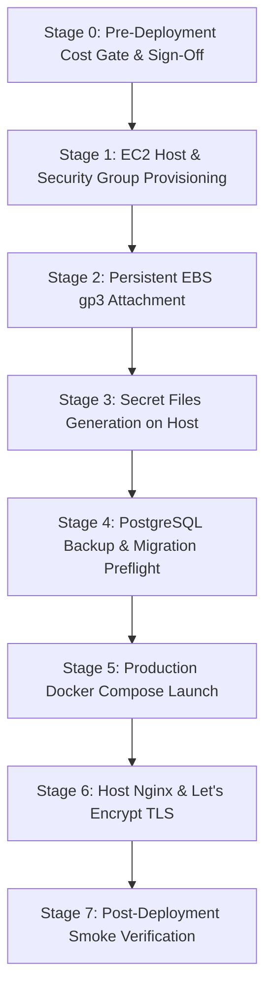

# InfraPulse — AWS Deployment Operational Runbook

**Platform**: InfraPulse v2.4.0  
**Phase**: Phase 28 — Controlled Cloud Deployment  
**Target Region**: `ap-south-1` (Mumbai)  
**Profile**: Single-Host Hardened Production (`Option A`)  

---

## 1. Prerequisites & Gating Contract

Before running any command in this runbook, the operator MUST verify:
1. **Pre-Deployment Approval Gate** ([`AWS_DEPLOYMENT_COST_APPROVAL.md`](AWS_DEPLOYMENT_COST_APPROVAL.md)) is explicitly signed and authorized by the account owner.
2. **Quality Gates Complete**:
   - `npm run test:backend` (60 / 60 passed)
   - `npm run build:frontend` (82 modules compiled cleanly)
   - `node --test tests/production/securityHardening.test.mjs` (10 / 10 passed)
   - `node --test tests/production/selfMonitoring.test.mjs` (9 / 9 passed)
   - `node --test tests/production/productionPreparation.test.mjs` (18 / 18 passed)
   - `node scripts/securityAudit.js` (0 unredacted secrets)

> [!CAUTION]
> If Stage 0 has not been explicitly authorized by the user, **DO NOT PROCEED**. Halting at Stage 0 is the required policy when budget eligibility is unverified.

---

## 2. Step-by-Step Deployment Stages



---

### Stage 0: Pre-Deployment Cost Gate Verification
```bash
# Verify AWS caller identity and ensure target region is ap-south-1
aws sts get-caller-identity
# Confirm signed approval contract exists in docs/AWS_DEPLOYMENT_COST_APPROVAL.md
```

---

### Stage 1: AWS EC2 Host & Security Group Provisioning

1. **Create Security Group (`infrapulse-prod-sg`)**:
```bash
SG_ID=$(aws ec2 create-security-group \
  --group-name infrapulse-prod-sg \
  --description "InfraPulse Production Ingress" \
  --region ap-south-1 \
  --query 'GroupId' --output text)

# Allow HTTPS (443) from everywhere
aws ec2 authorize-security-group-ingress \
  --group-id "$SG_ID" --protocol tcp --port 443 --cidr 0.0.0.0/0 --region ap-south-1

# Allow HTTP (80) for Let's Encrypt challenge & redirect
aws ec2 authorize-security-group-ingress \
  --group-id "$SG_ID" --protocol tcp --port 80 --cidr 0.0.0.0/0 --region ap-south-1

# Allow SSH (22) strictly from Administrator IP
aws ec2 authorize-security-group-ingress \
  --group-id "$SG_ID" --protocol tcp --port 22 --cidr "<ADMIN_IP>/32" --region ap-south-1
```

2. **Launch EC2 Instance**:
```bash
INSTANCE_ID=$(aws ec2 run-instances \
  --image-id ami-00bb6a80f01f03502 \
  --instance-type t4g.small \
  --key-name infrapulse-prod-key \
  --security-group-ids "$SG_ID" \
  --region ap-south-1 \
  --block-device-mappings '[{"DeviceName":"/dev/xvda","Ebs":{"VolumeSize":20,"VolumeType":"gp3","Encrypted":true}}]' \
  --tag-specifications 'ResourceType=instance,Tags=[{Key=Project,Value=InfraPulse},{Key=Environment,Value=Production}]' \
  --query 'Instances[0].InstanceId' --output text)
```

---

### Stage 2: Persistent EBS gp3 Attachment

1. **Create & Attach 30 GB gp3 Data Volume**:
```bash
VOL_ID=$(aws ec2 create-volume \
  --availability-zone ap-south-1a \
  --size 30 \
  --volume-type gp3 \
  --encrypted \
  --tag-specifications 'ResourceType=volume,Tags=[{Key=Project,Value=InfraPulse},{Key=Name,Value=infrapulse-postgres-data}]' \
  --region ap-south-1 \
  --query 'VolumeId' --output text)

aws ec2 attach-volume \
  --volume-id "$VOL_ID" \
  --instance-id "$INSTANCE_ID" \
  --device /dev/sdf \
  --region ap-south-1
```

2. **Format and Mount on Host (SSH Session)**:
```bash
sudo mkfs.ext4 -m 1 /dev/nvme1n1
sudo mkdir -p /mnt/postgres-data
sudo mount /dev/nvme1n1 /mnt/postgres-data
echo "/dev/nvme1n1 /mnt/postgres-data ext4 defaults,nofail 0 2" | sudo tee -a /etc/fstab

# Create Docker volume linking to mount
docker volume create --driver local \
  --opt type=none \
  --opt device=/mnt/postgres-data \
  --opt o=bind postgres-data-prod
```

---

### Stage 3: Secure Production Secrets Generation

Execute on the hardened EC2 host (permissions restricted to `root:root 0600`):
```bash
sudo mkdir -p /opt/infrapulse/secrets
sudo chmod 0700 /opt/infrapulse/secrets

# Generate cryptographically secure random secrets
openssl rand -hex 24 | sudo tee /opt/infrapulse/secrets/app_db_password > /dev/null
openssl rand -hex 24 | sudo tee /opt/infrapulse/secrets/admin_db_password > /dev/null
openssl rand -hex 32 | sudo tee /opt/infrapulse/secrets/integration_key > /dev/null

sudo chmod 0600 /opt/infrapulse/secrets/*
```

---

### Stage 4: Database Preflight & Migrations

1. **Verify Database Connectivity over Unix Socket**:
```bash
docker compose -f deploy/production/compose.yml run --rm postgres \
  pg_isready -h /var/run/postgresql -U migration_admin -d infrapulse
```

2. **Execute Database Backup Before Migrations**:
```bash
# Execute logical pre-migration dump
docker exec -t infrapulse-postgres pg_dump -U migration_admin -d infrapulse -F c -b -v \
  -f /var/lib/postgresql/data/backup_pre_migration.dump
```

3. **Run Migrations (001 through 022)**:
```bash
docker compose -f deploy/production/compose.yml run --rm backend \
  node src/entrypoint.js migrate
```

---

### Stage 5: Production Docker Compose Launch

Deploy immutable, pinned images:
```bash
cd /opt/infrapulse
export PUBLIC_ORIGIN="https://app.infrapulse.io"
export PGDATA_VOLUME="postgres-data-prod"
export APP_DB_PASSWORD_FILE="/opt/infrapulse/secrets/app_db_password"
export ADMIN_DB_PASSWORD_FILE="/opt/infrapulse/secrets/admin_db_password"
export INTEGRATION_KEY_FILE="/opt/infrapulse/secrets/integration_key"

# Validate compose configuration before starting
node scripts/validate-production-compose.mjs --env-file /opt/infrapulse/.env.production

# Launch containers
docker compose -f deploy/production/compose.yml up -d
```

---

### Stage 6: Host Nginx & Automated TLS Configuration

1. **Configure Host Nginx (`/etc/nginx/sites-available/infrapulse.conf`)**:
```nginx
server {
    listen 80;
    server_name app.infrapulse.io;
    location /.well-known/acme-challenge/ { root /var/www/certbot; }
    location / { return 301 https://$host$request_uri; }
}

server {
    listen 443 ssl http2;
    server_name app.infrapulse.io;

    ssl_certificate /etc/letsencrypt/live/app.infrapulse.io/fullchain.pem;
    ssl_certificate_key /etc/letsencrypt/live/app.infrapulse.io/privkey.pem;
    ssl_protocols TLSv1.2 TLSv1.3;
    ssl_ciphers HIGH:!aNULL:!MD5;

    add_header Strict-Transport-Security "max-age=31536000; includeSubDomains" always;
    add_header X-Content-Type-Options "nosniff" always;
    add_header X-Frame-Options "DENY" always;

    location / {
        proxy_pass http://127.0.0.1:8080;
        proxy_set_header Host $host;
        proxy_set_header X-Real-IP $remote_addr;
        proxy_set_header X-Forwarded-For $proxy_add_x_forwarded_for;
        proxy_set_header X-Forwarded-Proto https;
    }
}
```

2. **Obtain SSL Certificate**:
```bash
sudo certbot --nginx -d app.infrapulse.io --non-interactive --agree-tos -m admin@infrapulse.io
sudo systemctl reload nginx
```

---

### Stage 7: Post-Deployment Smoke Verification

Execute health checks against the public endpoint:
```bash
# 1. Frontend Liveness
curl -fsSL -o /dev/null https://app.infrapulse.io/

# 2. Backend Liveness probe
curl -fsSL https://app.infrapulse.io/api/health/live

# 3. Backend Readiness probe
curl -fsSL https://app.infrapulse.io/api/health/ready

# 4. Prometheus Scrape endpoint (protected / restricted)
curl -fsSL https://app.infrapulse.io/metrics

# 5. Self-Monitoring Overview
curl -fsSL https://app.infrapulse.io/api/self-monitoring/overview
```

---

### Stage 8: Emergency Kill-Switch & Isolation

If anomalies or unexpected costs occur:
```bash
# Immediate container shutdown (preserves persistent EBS volume)
docker compose -f deploy/production/compose.yml down

# Disassociate Elastic IP to stop public traffic
aws ec2 disassociate-address --association-id "$ASSOC_ID" --region ap-south-1
```

