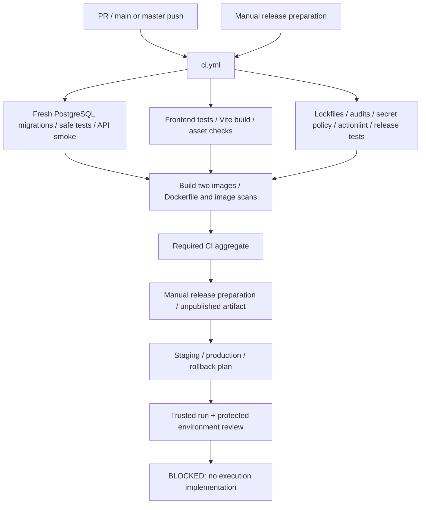

# CI/CD architecture

Phase 25, 2026-11-01. **Implemented foundations; no deployment or publication.** Remote GitHub execution is NOT TESTED. Application production readiness remains NO-GO under [Phase 24](PHASE_24_DEPLOYMENT_PREPARATION_REPORT.md). The [Phase 25 report](PHASE_25_CICD_RELEASE_AUTOMATION_REPORT.md) owns actual execution results.

## Workflow graph

## Reused and new workflows

| Workflow | Purpose / trigger | Boundary |
|---|---|---|
| `.github/workflows/ci.yml` | Existing CI expanded; PR and main/master push, reusable `workflow_call` | Tests/build/scans only. `Required CI` fails if any required job fails, cancels or skips. |
| `benchmark.yml` | Existing isolated performance workflow, manual or weekly | Fixed disposable loopback target; scheduled runner work is opt-in through `ENABLE_SCHEDULED_BENCHMARKS=true`. Existing benchmark accuracy is not certified as a release gate. |
| `release.yml` | Manual version + `PREPARE ONLY`; reuses complete CI | Main-only artifact preparation, `release-review` environment reference. No tag, registry push or GitHub Release creation. |
| `deployment-plan.yml` | Shared reusable implementation | Checks trusted release run/artifact and existing environment rules, then waits at the selected environment. Generates a blocked plan only. |
| `staging.yml` / `production.yml` | Separate manual entrypoints | Environment-specific wrapper; no secrets inherited and no deployment commands. |
| `rollback.yml` | Manual previous-version plan | Defaults to staging; same approval/provenance checks, older-version requirement and disabled execution. |

Independent job timeouts are 2–25 minutes; concurrency cancels redundant CI but does not cancel in-progress environment plans. Reusable/caller concurrency keys differ to avoid self-cancellation. npm cache keys include all three lockfiles; caches contain package downloads, not environments, database data or candidate artifacts. Checkouts do not persist Git credentials. GitHub runner checkout is part of future workflow behavior; **no Git command was run locally in Phase 25**.

## Test isolation

The generic scripts under `scripts/ci/` replace machine-specific Phase 24 harness imports in automated CI. Database-mutating steps require loopback PGHOST, explicit PGPORT, `NODE_ENV=test`, matching `PGDATABASE`/`PGDATABASE_TEST` with prefix `infrapulse_ci_`, and `CI_DISPOSABLE_DATABASE=true`. Migration initialization additionally requires an empty public schema. Existing databases are never reset or restored over.

The configured PostgreSQL service is disposable and digest pinned. Its declared password is a public **test fixture**, never a deployment credential. The normal API and worker production identity remains unresolved under P24-01; privileged disposable test connections do not waive that blocker.

Safe tests lock all five execution flags false, clear ordinary/profile/web-identity/container AWS credential sources, disable metadata and external notification/AI delivery, and opt out of live tests. The original mutation-oriented suites remain unchanged and explicitly excluded; see `reports/ci/excluded-tests.json` and [security policy](CI_SECURITY_POLICY.md). Existing 60 default backend cases run, plus the wider safe regression selection and Phase 24 preparation tests. No existing assertion was removed to get green output.

## Build and evidence flow

Frontend `npm test` includes a production Vite build; asset structure and hashes are checked afterward. Backend integration launches the real guarded entrypoint on an allocated loopback port, checks production configuration, readiness/liveness, HTTPS gating, cookie auth and tenant service access, then shuts down its owned child. HTTPS proxy headers are simulated; real TLS/browser/container behavior is not claimed.

Container automation reuses both existing Dockerfiles, now pinned to public base-image manifest digests. It builds **linux/amd64 only** with full source-SHA and semantic-version local tags, records content image IDs, scans HIGH/CRITICAL findings without ignoring unfixed issues, and never logs in or pushes. Worker uses the backend image with the worker command. ARM/Graviton remains unsupported until separately built and tested; the Phase 24 t4g proposal cannot consume these images without that work.

Ordinary CI uploads bounded test/build/policy/scan evidence. Image tar exports are enabled only by the reusable release-preparation call, retained for one day; candidate artifacts are retained seven days. No raw DB dump, actual environment, secret directory or complete workspace is uploaded. Failure logs and TAP results are allowlisted. Artifacts/caches and hosted minutes can incur GitHub charges beyond allowances; no account quota or zero-cost claim was verified and no remote run was triggered here.

Candidate manifests bind version, source commit, relative filenames, byte counts and SHA-256 values, including nested image archives/metadata. Missing/extra/duplicate/traversing/symlinked/tampered files are rejected. Checksums prove integrity, not authorship: deployment plans also require a successful same-repository/main manual release run and Required CI, with an exact artifact ID selected before download. GitHub API/digest/download behavior and repository protection settings remain unverified in this environment.

No CI success automatically authorizes production. Known lifecycle/security/recovery findings remain open, candidate metadata says `productionReady:false`, and execution has no implemented path. See [release management](RELEASE_MANAGEMENT.md), [pipeline runbook](DEPLOYMENT_PIPELINE_RUNBOOK.md) and [rollback](ROLLBACK_AUTOMATION.md).
