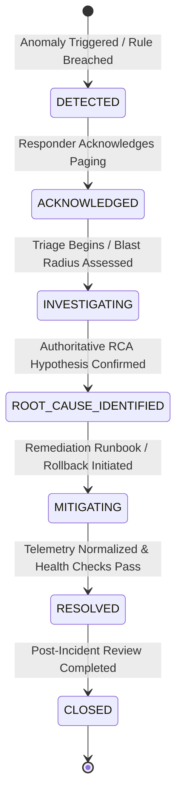

# InfraPulse — Incident Response Workflow & Lifecycle Governance

## 1. Incident Lifecycle State Machine

InfraPulse enforces a strict, deterministic lifecycle state machine for all operational incidents. State transitions are validated by role permissions, recorded in immutable audit logs, and synchronized across distributed timelines.



### 1.1 State Definitions & Exit Criteria

1. **`DETECTED`**:
   - Anomaly rules breached or manual incident declared.
   - Paging alerts triggered to on-call engineers.
   - Initial incident record created in PostgreSQL (`incidents` table).
2. **`ACKNOWLEDGED`**:
   - On-call engineer or Incident Commander acknowledges the incident via UI, Slack action, or API.
   - Confirms MTTA SLA compliance.
3. **`INVESTIGATING`**:
   - Active triage underway.
   - Deterministic RCA engine evaluates metrics, dependencies, traces, and deployment logs.
   - Blast radius and impacted callers identified.
4. **`ROOT_CAUSE_IDENTIFIED`**:
   - Authoritative hypothesis confirmed (e.g., connection pool exhaustion on `srv-payments` following release v1.8.3).
   - Targeted remediation actions formulated.
5. **`MITIGATING`**:
   - Remediation underway (e.g., automated or supervised runbook execution, pod restart, deployment rollback, traffic drain).
   - Temporary workarounds applied.
6. **`RESOLVED`**:
   - Technical recovery achieved. All service health metrics return within normal baseline thresholds ($P_{99} < 400\text{ ms}$, error rate $< 0.1\%$).
   - Customers no longer experience active impact.
7. **`CLOSED`**:
   - Post-Incident Review (PIR) completed, action items created in backlog, root causes documented.

---

## 2. Command Team Roles & Responsibilities

During `SEV-1` and `SEV-2` incidents, clear separation of operational duties prevents chaos:

```
                  +--------------------------------+
                  |    INCIDENT COMMANDER (IC)     |
                  | Owns strategy, decisions, pace |
                  +---------------+----------------+
                                  |
            +---------------------+---------------------+
            |                                           |
            v                                           v
+-----------------------+                   +-----------------------+
|  TECHNICAL LEAD (TL)  |                   |  COMMUNICATIONS LEAD  |
| Directs RCA, runbooks,|                   | External status page, |
| fixes & verification  |                   | executive updates     |
+-----------------------+                   +-----------------------+
```

1. **Incident Commander (IC)**:
   - Holds overall accountability for incident resolution.
   - Sets the investigation strategy, assigns tasks, approves high-risk remediation actions, and controls communication cadences.
   - Does not touch keyboards or debug code directly.
2. **Technical Lead / SRE On-Call (TL)**:
   - Leads technical diagnosis, reviews Deterministic RCA candidate rankings, inspects logs and traces, and executes authorized runbooks.
3. **Communications Lead (CL)**:
   - Drafts status page updates, manages customer-facing communication, and updates internal executive stakeholders every 15 minutes.

---

## 3. Decoupled Notification Dispatch & Idempotency

The InfraPulse notification subsystem (`backend/src/services/notification.service.js` and `notificationDispatcher.service.js`) delivers asynchronous, reliable paging without blocking API threads:

1. **Strict Idempotency Keys**:
   - Every delivery generates a unique deterministic idempotency key:
     `{eventType}_{incidentId}_{channelId}_{severity}_{qualifier}`
   - Prevents duplicate SMS or Slack pages if an evaluation loop repeats or retries.
2. **Channel Fan-Out**:
   - Supported channels: Slack webhooks, email (SMTP/SES), PagerDuty API, and generic secure webhooks.
3. **Exponential Backoff & Retries**:
   - Transient delivery failures retry with jittered exponential backoff:
     $$\text{Delay}(n) = \min(60\text{s}, 2^n \cdot 1000\text{ms} + \text{jitter})$$
   - Maximum 5 attempts before marking status as `failed` and raising dead-letter alerts.
4. **Mock Mode Safety**:
   - In non-production testing environments, `NOTIFICATION_MOCK_MODE=true` logs rendered templates and payloads without sending live customer notifications.

---

## 4. Runbook Orchestration & Remediation

InfraPulse integrates incident workflows with executable runbooks (`backend/src/services/runbookExecution.service.js`):
- **Dry-Run Mode**: Inspect expected mutations, API calls, and parameter validation without modifying infrastructure.
- **Safety Circuit Breakers**:
  - `REMEDIATION_EXECUTION_ENABLED=false` enforces safety in environments where live cloud mutations are prohibited.
  - SRE Responder or Admin role required (`requireRole('admin', 'responder')`).
- **Post-Remediation Verification**: Automatic metric probe confirms error rate drops below threshold before state moves to `RESOLVED`.

---

## 5. Post-Incident Review (PIR) & Blameless Postmortem

For all `SEV-1` and `SEV-2` incidents, a blameless postmortem is conducted within 48 hours:
1. **Automated Timeline Generation**: The incident timeline automatically aggregates all alert firings, responder actions, investigation runs, runbook executions, and metric recovery timestamps.
2. **Five Whys & Root Cause Documentation**: Identifies systemic, architectural, and procedural contributors.
3. **Action Items Tracking**: Backlog items created with explicit owners and SLA due dates to eliminate repeat failure modes.
