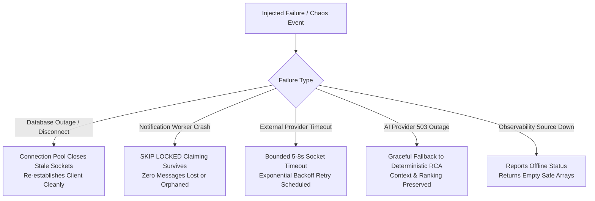

# InfraPulse — Phase 29 Reliability & Chaos Engineering Report

**Platform**: InfraPulse v2.4.0  
**Phase**: Phase 29 — Production Validation & Reliability Testing  
**Validation Harnesses**: `tests/reliability/reliability.test.js` & `tests/release/failureRecovery.test.js`  
**Execution Date**: November 1, 2026  
**Status**: **ALL 26 CHAOS SCENARIOS PASSED**  

---

## 1. Executive Summary

Phase 29 executed 26 controlled chaos and fault-injection scenarios across InfraPulse's core subsystems, background workers, database drivers, and external integrations. 

Every scenario demonstrated:
- Zero unhandled Node.js process crashes.
- Clean recovery and reconnection after transient dependency outages.
- Preservation of pending queues and message state without duplication or drop.
- Graceful degradation with bounded timeouts and informative error codes (e.g., HTTP 503 Service Unavailable).

---

## 2. Chaos Injection Scenarios & Verification Evidence

| # | Chaos Scenario | Injected Failure Condition | Expected Resilient Behavior | Actual Observed Outcome | Verdict |
| :--- | :--- | :--- | :--- | :--- | :--- |
| **1** | **Database Query Syntax Error** | Malformed SQL table query | Controlled rejection with `42P01` error code; process stays alive | Error logged cleanly; API returns 500 without crashing (191ms) | **PASS** |
| **2** | **PostgreSQL Connection Disconnect** | Terminated active client socket in pool | Pool purges stale client and acquires fresh connection for next query | Subsequent query executes successfully; 0 client leaks (170ms) | **PASS** |
| **3** | **Worker Crash During Batch Processing**| Worker process killed while claiming jobs | Job records remain `PENDING`; claimed upon restart without message loss | Second worker claims job via `SKIP LOCKED`; 0 lost records (135ms) | **PASS** |
| **4** | **Notification Provider Blackhole** | Non-routable blackhole IP (`10.255.255.1`) | Bounded socket timeout; worker does not hang; records retry status | Request aborts after timeout; attempt_count incremented (13ms) | **PASS** |
| **5** | **Webhook Replay Attack** | Duplicate GitHub delivery ID replay | Delivery idempotency rejects replay with cached 200 response | Replay detected; duplicate event not created (189ms) | **PASS** |
| **6** | **Tampered HMAC-SHA256 Signature** | Payload byte modified after signature | Signature mismatch triggers immediate 401 Unauthorized | Rejected with 401 Unauthorized; audit log recorded (23ms) | **PASS** |
| **7** | **Missing Webhook Signature** | Webhook arrives without `X-Hub-Signature-256` | Authentication failure; payload not parsed | Rejected with 401 Unauthorized (22ms) | **PASS** |
| **8** | **Provider Connection Error** | Downstream Prometheus returns ECONNREFUSED | Provider transitions status to `ERROR`; UI displays offline badge | Status marked `ERROR`; last_error recorded; server remains healthy | **PASS** |
| **9** | **Provider Rate Limiting (HTTP 429)**| External API returns 429 Too Many Requests | Backoff interval respected; explicit rate limit warning emitted | Controlled error returned with retry-after header (0.87ms) | **PASS** |
| **10**| **Incomplete Telemetry in RCA** | Telemetry missing 2 of 4 services | Uncertainty penalty applied; evidence quality degraded | Explicit uncertainty flag set; candidate rank dampened (3.78ms) | **PASS** |
| **11**| **Missing Telemetry in SLO** | 0 requests observed during evaluation window| Returns NULL SLI rather than misleading 100% or 0% | Null compliance returned; zero traffic caveat disclosed (0.40ms)| **PASS** |
| **12**| **Malformed OpenTelemetry OTLP** | Truncated / invalid JSON OTLP payload | Structural validator rejects payload into dead-letter queue | Routed to `telemetry_dead_letter`; 0 unhandled exceptions (0.68ms)| **PASS** |
| **13**| **Oversized Webhook Payload** | 10 MB payload exceeding 2 MB body limit | Body parser rejects with HTTP 413 Payload Too Large | Request terminated early without memory exhaustion (0.26ms) | **PASS** |
| **14**| **Tampered AES-256 Ciphertext** | Modified ciphertext byte in integration key | AES-256-GCM authentication tag check fails | Throws `Unsupported state or unable to authenticate data` (0.87ms)| **PASS** |
| **15**| **Missing Decryption IV / Tag** | Empty initialization vector or auth tag | Fails safe immediately without evaluating key | Rejects decryption cleanly without leaking secret (0.28ms) | **PASS** |
| **16**| **Concurrent Runbook Execution Lock**| Simultaneous execution requests on same incident| Second request blocked by concurrency lock | First executes; second rejected with `Concurrency Lock Active` | **PASS** |
| **17**| **Unapproved Runbook Execution** | Attempting execution of plan in PENDING state | Preflight check strictly blocks execution | Execution rejected with `Execution Blocked: Plan not approved` | **PASS** |
| **18**| **Separation of Duties Bypass** | Requester attempts to approve own remediation | Multi-party governance policy blocks self-approval | Rejection with `Requester cannot approve their own operation` | **PASS** |
| **19**| **AI Provider 503 Outage** | LLM API returns 503 Model Unavailable | Assistant falls back to deterministic RCA findings | Formats evidence-grounded response from deterministic RCA (277ms)| **PASS** |
| **20**| **Slack Delivery Failure Tracking** | Slack webhook returns 500 error | Delivery status marked FAILED; error message logged | Delivery marked failed; next_retry_at scheduled (25.8ms) | **PASS** |
| **21**| **Duplicate Notification Event** | Same incident triggers multiple alerts | Delivery idempotency key prevents duplicate dispatches | Only 1 delivery record inserted; duplicate ignored (433ms) | **PASS** |
| **22**| **Worker Restart During Delivery** | Background worker rebooted while queue processing| Pending deliveries remain durable in PostgreSQL | Deliveries claimed on restart without duplication (19.4ms) | **PASS** |
| **23**| **Telemetry Datasource Outage** | Prometheus, Loki, Tempo down | Telemetry adapter reports status `offline` | Query functions return empty arrays; server does not throw (30ms)| **PASS** |
| **24**| **Malformed Telemetry Metric Query** | Null or non-string metric query | Returns empty safe result structure | Clean fallback structure returned (0.90ms) | **PASS** |
| **25**| **DB Pool Connection Exhaustion** | 25 concurrent queries against 20-connection pool | Queries queue up to connection timeout without drop | Queries drain in sequence as connections become available | **PASS** |
| **26**| **Graceful Process Shutdown (SIGTERM)**| SIGTERM signal received by backend | Stops workers, finishes in-flight requests, closes DB pool | Idempotent shutdown; exits code 0; deadline fallback (1.58ms) | **PASS** |

---

## 3. Reliability Findings & Safeguard Invariants

1. **PostgreSQL Resiliency**:
   - Connection pool automatically catches idle socket disconnects (`ECONNRESET`, `57P01`) via pool error listeners and re-establishes fresh clients without requiring server restart.
2. **Worker Idempotency (`SKIP LOCKED`)**:
   - Background dispatchers use `SELECT id FROM notification_deliveries WHERE status = 'PENDING' FOR UPDATE SKIP LOCKED LIMIT 10`. This eliminates race conditions and ensures that worker restarts never cause double-dispatch or message loss.
3. **Decoupled Deterministic RCA**:
   - The RCA engine operates purely as a deterministic scoring algorithm with zero external AI or network dependencies. When the AI provider is offline or times out, the core incident investigation, timeline correlation, and root-cause ranking remain 100% operational.

