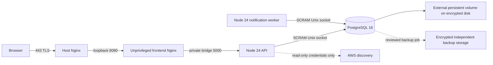

# Production deployment architecture

Prepared 2026-11-01. Region: **ap-south-1 (Mumbai)**. Status: **design prepared; deployment NO-GO**. This document supersedes production assumptions in the historical [AWS template](aws-ap-south-1-deployment-template.md). No AWS account changes or infrastructure provisioning were performed. The [Phase 24 report](PHASE_24_DEPLOYMENT_PREPARATION_REPORT.md) owns release gates; [cost estimates](PRODUCTION_COST_ESTIMATES.md) own pricing assumptions.

## Options and decision

| Option | Application and storage | Operations / security | Monthly planning estimate, before tax | Free Tier / resources |
|---|---|---|---|---|
| A: EC2 single host | Host TLS Nginx; frontend Nginx, API, notification worker and PostgreSQL containers; encrypted persistent gp3 data; independent off-host backups | Lowest infrastructure complexity, highest operator responsibility for patching, DB recovery and host failure. Single host/AZ is a failure domain; no HA claim. | 4 GiB: **$30–45**; 8 GiB: **$46–70**, scenario allowances rather than a spending cap | No credits assumed. Proposed t4g.medium / t4g.large, 2 vCPU, 50 GiB total EBS initially; ARM images require validation. |
| B: ECS Fargate + RDS | S3/CloudFront SPA, HTTPS ALB API origin, separate API/worker tasks, private RDS PostgreSQL, ECR, CloudWatch, outbound NAT or reviewed endpoint design | Less host work, more network/IAM/cost configuration. Requires task definitions, correct proxy trust, TLS and RDS migration-role validation; these are **not implemented or deployed** in this phase. | Single-AZ DB baseline **$150–220**; proposed HA deployment **$250–400+** | No credits assumed. API 0.5 vCPU/1 GiB, worker 0.25 vCPU/0.5 GiB, RDS db.t4g.small initially, at least 20 GiB DB storage. HA needs more tasks/AZs and a separately quoted Multi-AZ DB. |
| C: Lightsail single host | Same container application, local PostgreSQL, included disk/transfer, host TLS, snapshots plus independent logical backups | Simple bundled compute, still self-managed DB and single-host recovery. Check IAM, disk encryption, outbound connectivity and snapshot isolation before selection. | 4 GiB **$29–40**; 8 GiB **$50–65**, with stated backup/DNS/log allowances | No trial assumed. 4 GiB bundle includes 80 GB disk; Mumbai transfer allowance differs from the generic global table. |

**Preparation target: option A**, as a controlled small pilot after gates close, with 8 GiB preferred when telemetry services are colocated. This is a conditional design choice, not authorization to incur charges. None of these complete architectures has a verified ₹0 bill. Keep the existing local development setup while the ₹0 budget and safety blockers remain unresolved. Option B is the longer-term availability/recovery candidate; do not run this single-host Compose file as an ECS task definition. EKS is deferred: control-plane and operational costs offer no demonstrated benefit for this workload and budget.

## Reviewed single-host boundary

The future backup job and AWS identity are design elements, not deployed services. The provided Compose draft has four core services; it does not configure off-host backups, WAL archival, IAM, certificates, DNS, alarms or notification providers.

- Only the host edge may accept public 443; use 80 only for fixed-domain HTTPS redirect/ACME if selected. Host SSH must be limited to a reviewed administrative source, or replaced by an approved management channel. Do not expose 5000, 5432, 8080, Docker, telemetry UIs or database sockets to the Internet.
- `deploy/production/compose.yml` publishes only `127.0.0.1:8080`. API/worker have no published ports. PostgreSQL has `network_mode: none` and `listen_addresses=''`; clients use an authenticated shared Unix socket. Disabling DB TLS is allowed only on the reviewed local socket/loopback transport. No TCP PostgreSQL security-group ingress is needed for A.
- The host proxy overwrites forwarded protocol/client-IP headers; the container frontend preserves those reviewed values. Express trusts one private frontend hop. **Do not expose the frontend listener publicly or reuse `TRUST_PROXY=1` behind an unreviewed topology.** Shared local host administrators are trusted. Test spoofed forwarded headers at the deployed edge before release.
- Remote/RDS connections require `PGSSLMODE=verify-full` and a CA bundle, with server name verification. The Compose socket transport must be replaced by reviewed private TCP/TLS configuration for B. [RDS TLS guidance](https://docs.aws.amazon.com/AmazonRDS/latest/UserGuide/UsingWithRDS.SSL.html).
- HTTPS certificates, renewal, domain ownership and DNS records are not created here. The host template uses `app.example.invalid` deliberately; replace it with an owned name before a gated rehearsal. Validate DNS, certificate chain/expiry and automatic renewal in isolation.
- No Docker socket, kubeconfig, static AWS credentials or production data directory is mounted into API/worker. Do not attach a root/admin AWS identity. A workload role must implement the existing [read-only IAM policy](aws-iam-read-only-policy.md), restricted to intended region/resources where supported. Instance-metadata access is disabled in the Compose draft; an EC2 workload-identity design must account for IMDSv2/hop restrictions before deliberately changing that setting. Credential discovery and rotation remain unverified in this topology.
- Cloud lifecycle and remediation execution remain disabled. A disabled flag is an additional safeguard; it does not resolve the nineteen Phase 23N findings.

## Managed design boundaries

For B, place an Internet-facing ALB in two public subnets; restrict API task ingress to the ALB security group and RDS ingress to API/worker security groups on 5432. Worker tasks have no inbound rule. RDS stays private, encrypted and isolated from public routing. Private tasks require a paid outbound path for images, logs and external integrations: model NAT, or individually validated VPC endpoints plus an approved Internet-egress design. [ECS task networking](https://docs.aws.amazon.com/AmazonECS/latest/developerguide/task-networking-awsvpc.html).

CloudFront can serve the SPA and forward `/api/*` to ALB, preserving session/authorization/origin headers and disabling API caching. The extra proxy chain requires a separate trust/client-IP design and real security tests. Container DNS/proxy settings in the single-host draft do not implement this path. RDS recovery creates a new target; neither Multi-AZ nor automated backups replace a tested restore. [RDS point-in-time restore](https://docs.aws.amazon.com/AmazonRDS/latest/UserGuide/USER_PIT.html).

## Containers, identity and data

Backend/frontend builds remain multistage. Node 24 replaces the EOL Node 20 application runtime; a checksum-verified Windows Node 24.22.2 was exercised. Linux/ARM images remain unbuilt locally. Select reviewed immutable image digests after image scanning and runtime checks; floating builder tags in Dockerfiles are not a reproducible signed release. [Node release status](https://nodejs.org/en/about/previous-releases).

API/worker run as UID 1000, frontend as 101, with read-only root filesystems, bounded `/tmp`, dropped capabilities, `no-new-privileges`, PID/memory/CPU limits and a 30-second stop grace. PostgreSQL keeps the standard image entrypoint to initialize filesystem ownership, then runs as its database user; the bootstrap privilege exception and actual socket/secret permissions need Linux runtime verification. Existing PG volumes must already have correct SCRAM HBA settings; initialization flags do not retrofit an old volume.

An explicitly selected **external** data volume prevents accidental creation of a new empty production dataset on a typo. Never remove it during application rollout or rollback. Prepare/verify the mount and encrypted backing disk separately. The runtime DB login must differ from the migration/backup administrator. **P24-01 blocks deployment:** pre-tenant authentication currently fails under a non-bypass login role; using a superuser or weakening RLS is not an acceptable resolution. Logical restore also needs safe bootstrap of global policy roles and preserved grants.

## Resources and capacity

| Component | Proposed initial limit / allowance | Evidence / limitation |
|---|---|---|
| API | Compose: 0.75 CPU, 512 MiB; V8 old space 384 MiB, pool 6 | Native Node 24 idle RSS ~120.2 MiB; no sustained ingestion/load or container OOM test |
| Notification worker | 0.75 CPU, 512 MiB; pool 6 | Native idle RSS ~61.1 MiB. Batch size 10, interval 5 seconds, no overlapping polls; theoretical idle ceiling 120 attempts/minute, reduced by delivery duration. No external-provider throughput verified. |
| PostgreSQL | 1 CPU, 768 MiB, shared buffers 128 MiB, max connections 40 | Disposable test DB ~14.0 MiB, cluster buffers 24 MiB. Production settings were not load-tested. |
| Frontend | 0.25 CPU, 128 MiB | Production bundle builds and size-budget tests pass; Nginx RSS/browser Web Vitals unmeasured. |
| Host | Core pilot: 2 vCPU/4 GiB minimum planning allowance; 8–16 GiB for colocated telemetry | Core container limits total 1,920 MiB; reserve OS/Docker/proxy, filesystem cache and backup headroom. Optional OTel/Prometheus/Loki/Tempo are absent from the production core draft. |

API+worker pools allow up to 12 ordinary connections for one replica each; reserve administrator/backup/migration and health capacity below the 40-connection server limit. Two API replicas plus two workers require up to 24 plus reserves. Validate this before scaling; do not increase replica/pool counts independently.

At **1 event/second × 1 KiB**, raw payload is ~2.47 GiB/month; assuming 2–4× relational/index overhead yields ~4.9–9.9 GiB/month. At 10 events/second that becomes ~49–99 GiB/month. These are arithmetic planning scenarios, not measured compression/retention. Trace/log payloads and WAL can be much larger. Define retention, quotas, partition/maintenance strategy and disk alerts before production. A 50 GiB host allocation is unsuitable for unbounded telemetry. Reserve at least one extra full restore target plus archive storage; retention and WAL needs must be measured separately.

Idle loopback readiness measured 20 requests, median ~2.93 ms / p95 ~6.72 ms. This tests an almost empty local database and is **not** an API SLO, end-user latency, capacity or AWS benchmark. See [raw measurements](../reports/phase24/measurements-node24.json).

## Operations before release

Centralize structured application logs with bounded retention and query-free access logging; scan existing console/error paths and the actual Nginx error logs for credential leakage. Alert on readiness, worker heartbeat failures/age, queue depth/oldest item, pool waits, disk/WAL growth, backup freshness/restore failures, CPU credits, memory/OOM, certificate expiry and cost anomalies. Container health alone does not restart unhealthy containers or prove business correctness; select and test an operational response. Real provider notifications, log transport, alarms, retention and budgets are not configured or verified here.

Resolve Phase 23N governance/scheduler/crash-recovery defects, P24-01, controlled first-admin onboarding and a real recovery drill before any public launch. Use the [runbook](PRODUCTION_DEPLOYMENT_RUNBOOK.md) and [rollback plan](PRODUCTION_ROLLBACK_PLAN.md); this design grants no readiness exception.
