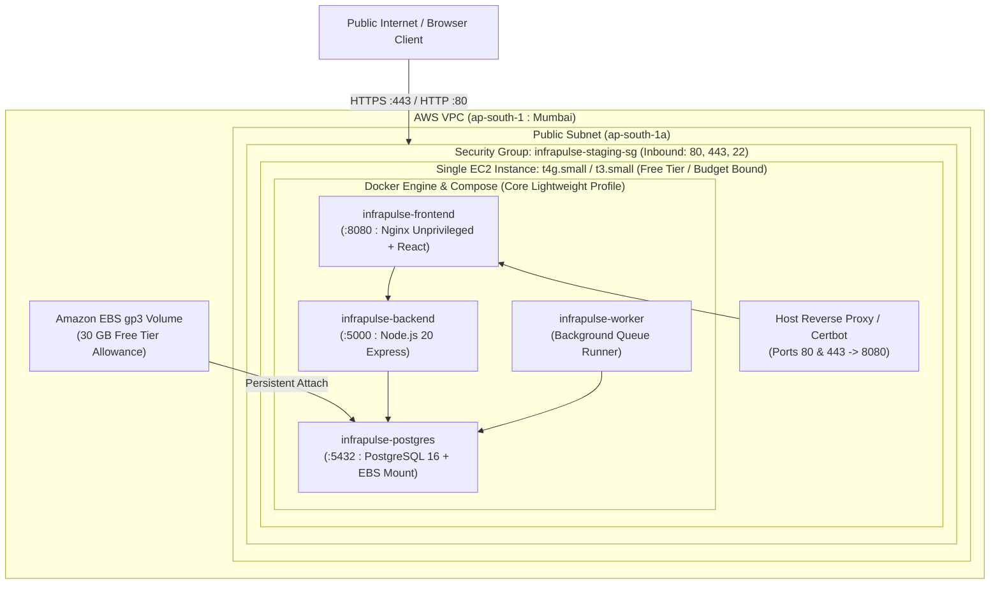

# InfraPulse — AWS ap-south-1 (Mumbai) Deployment Template

> Historical template. Phase 24 supersedes its zero-cost assumptions, Node version and production configuration. Account credits and Free Tier eligibility are unverified; no deployment is authorized. Use [current architecture](PRODUCTION_DEPLOYMENT_ARCHITECTURE.md), [cost estimates](PRODUCTION_COST_ESTIMATES.md) and the [gated runbook](PRODUCTION_DEPLOYMENT_RUNBOOK.md).

This specification defines the deployment architecture and configuration template for running InfraPulse on a single Amazon EC2 instance in **`ap-south-1` (Mumbai)** within a **strictly zero out-of-pocket** budget model.

> [!IMPORTANT]
> **Strict Zero Out-of-Pocket Rule**:
> No AWS resources are provisioned by this task. This document serves as the implementation template and operational runbook for future zero-cost deployment using eligible AWS Free Tier credits and compute allowances.

---

## 1. Zero Out-of-Pocket Architecture for ap-south-1



---

## 2. Resource & Budget Planning (ap-south-1)

| AWS Resource | Specification | Zero-Cost / Free Tier Eligibility | Memory Footprint |
| :--- | :--- | :--- | :--- |
| **EC2 Instance** | `t4g.small` (2 vCPU, 2 GB RAM) or `t3.micro` / `t3.small` | 750 hours/month Free Tier eligible (where applicable) | ~2048 MB total capacity |
| **EBS Storage** | 30 GB `gp3` or `gp2` | 30 GB/month Free Tier root + data allowance | Persistent disk |
| **Elastic IP** | 1 IPv4 address attached to running instance | Free while attached to running instance | N/A |
| **Data Transfer** | Outbound data under 100 GB/month | 100 GB/month free outbound data across regions | N/A |

### Memory Constraint Analysis: Lightweight vs. Full Profile
Running the full telemetry stack (Prometheus + Grafana + Tempo + Loki + OpenTelemetry Collector + PostgreSQL + Backend + Worker + Frontend) requires ~4.5 GB to 6 GB of RAM. Attempting to run the full stack on a 1 GB–2 GB free-tier EC2 instance will trigger the Linux Out-Of-Memory (OOM) Killer.

**InfraPulse Solution**:
1. **Lightweight Staging Profile (`core`)**:
   - Services: `frontend`, `backend`, `worker`, `postgres`.
   - Telemetry Mode: `TELEMETRY_MODE=demo` (synthetic in-memory generator with deterministic incident simulation).
   - Peak Memory Usage: **~480 MB – 650 MB**.
   - Perfect for single EC2 instances in `ap-south-1`.
2. **Full Local Profile (`--profile telemetry`)**:
   - Run on developer workstations or dedicated multi-node staging clusters with 8 GB+ RAM.

---

## 3. Security Group Rules (ap-south-1)

Create a dedicated Security Group: `infrapulse-staging-sg` in `ap-south-1`.

| Type | Protocol | Port Range | Source | Justification |
| :--- | :--- | :--- | :--- | :--- |
| **HTTPS** | TCP | `443` | `0.0.0.0/0` | Secure public access to InfraPulse Web UI and APIs |
| **HTTP** | TCP | `80` | `0.0.0.0/0` | Let's Encrypt ACME challenges & redirect to HTTPS |
| **SSH** | TCP | `22` | `<Admin_Trusted_IP>/32` | Administrative shell access (Never `0.0.0.0/0`) |

> [!CAUTION]
> All internal ports (`5000` for backend, `5432` for PostgreSQL, `9090`, `3200`, `3100`, `4318`) MUST NOT be exposed on public interfaces. They are bound strictly to `127.0.0.1` or the internal Docker bridge network (`infrapulse-staging-net`).

---

## 4. EC2 Cloud-Init / User-Data Provisioning Script

When launching the EC2 instance in `ap-south-1`, supply the following cloud-init script:

```yaml
#cloud-config
package_upgrade: true
packages:
  - git
  - curl
  - jq
  - htop

# Configure 2GB Swap file to guard against memory spikes on low-cost instances
bootcmd:
  - [ sh, -c, "if [ ! -f /swapfile ]; then fallocate -l 2G /swapfile && chmod 600 /swapfile && mkswap /swapfile && swapon /swapfile && echo '/swapfile none swap sw 0 0' >> /etc/fstab; fi" ]

# Install Docker Engine & Docker Compose Plugin
runcmd:
  - curl -fsSL https://get.docker.com | sh
  - systemctl enable --now docker
  - usermod -aG docker ubuntu || usermod -aG docker ec2-user
  - mkdir -p /opt/infrapulse /opt/infrapulse/backups
  - chown -R ubuntu:ubuntu /opt/infrapulse || chown -R ec2-user:ec2-user /opt/infrapulse
```

---

## 5. Deployment Step-by-Step on ap-south-1 EC2

### 5.1 Clone Repository & Setup Working Directory
```bash
cd /opt/infrapulse
git clone https://github.com/KartikMandake/InfraPulse.git .
```

### 5.2 Configure Environment File
```bash
cp .env.staging.example .env.staging
chmod 600 .env.staging
```
Edit `.env.staging` and supply your strong generated PostgreSQL password and encryption key:
```bash
# Generate secure random 32-character key for envelope encryption:
INTEGRATION_KEY=$(openssl rand -hex 16)
sed -i "s/replace_with_staging_aes256_secret_key_32bytes!/$INTEGRATION_KEY/g" .env.staging
```

### 5.3 Launch Lightweight Staging Profile
```bash
# Starts only frontend, backend, worker, and postgres (consumes ~550MB RAM)
docker compose -f deploy/docker-compose.staging.yml --env-file .env.staging up -d --build
```

### 5.4 Verify Core Services
```bash
docker compose -f deploy/docker-compose.staging.yml ps
curl -s http://localhost:8080/healthz
curl -s http://localhost:5000/api/health/ready | jq .
```

---

## 6. Systemd Service for Automated EC2 Restarts

To ensure InfraPulse resumes automatically if the EC2 instance is rebooted:

Create `/etc/systemd/system/infrapulse.service`:
```ini
[Unit]
Description=InfraPulse SRE Observability Platform (Staging)
Requires=docker.service
After=docker.service network.target

[Service]
Type=oneshot
RemainAfterExit=yes
WorkingDirectory=/opt/infrapulse
ExecStart=/usr/bin/docker compose -f deploy/docker-compose.staging.yml --env-file .env.staging up -d
ExecStop=/usr/bin/docker compose -f deploy/docker-compose.staging.yml stop
TimeoutStartSec=300

[Install]
WantedBy=multi-user.target
```

Enable and activate the service:
```bash
sudo systemctl daemon-reload
sudo systemctl enable infrapulse.service
```

---

## 7. Zero-Downtime Rollback & Recovery on EC2

1. **Verify Backup before code update**:
   ```bash
   ./scripts/backup-db.sh /opt/infrapulse/backups
   ```
2. **Revert Image if needed**:
   ```bash
   docker compose -f deploy/docker-compose.staging.yml up -d --no-deps backend
   ```
3. **Database Restore**:
   ```bash
   ./scripts/restore-db.sh /opt/infrapulse/backups/<backup_name>.sql
   ```

