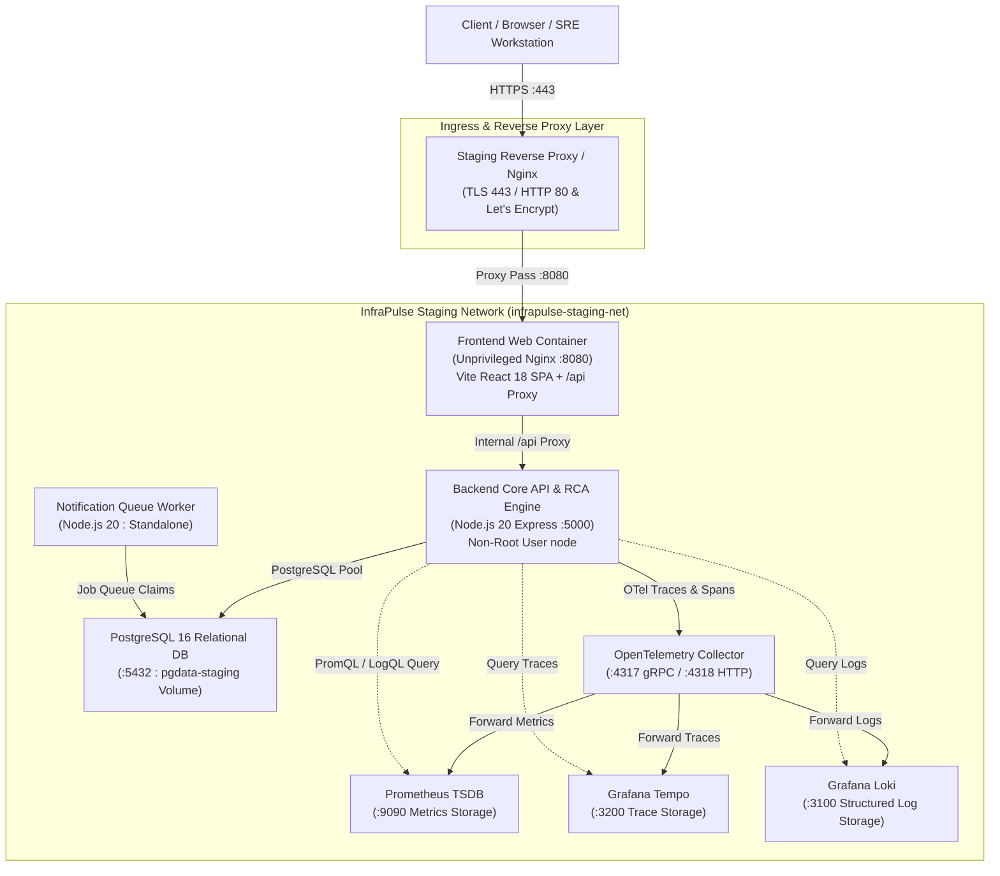

# InfraPulse — Phase 22: Staging Environment & Deployment Operations Manual

> Historical staging guide. Phase 24 now enforces HTTPS, strong secrets, manual migrations and verified remote PostgreSQL TLS. Existing staging templates need a reviewed TLS/CA/proxy overlay and fail closed without it. Do not use this guide as production approval; see [current configuration](PRODUCTION_ENVIRONMENT_CONFIGURATION.md) and [readiness report](PHASE_24_DEPLOYMENT_PREPARATION_REPORT.md).

This document provides complete operational procedures for deploying, maintaining, validating, and rolling back InfraPulse in a production-like staging environment.

---

## 1. Staging Deployment Architecture

InfraPulse utilizes an isolated, multi-container architecture orchestrated via Docker Compose, isolated on an internal bridge network (`infrapulse-staging-net`), with explicit health dependency gates and persistent storage.



---

## 2. Recommended Hosting Requirements

| Component | Minimum Staging Requirement | Recommended Production Specification |
| :--- | :--- | :--- |
| **Compute / Host** | 2 vCPUs, 4 GB RAM, x86_64 or ARM64 | 4 vCPUs, 8 GB RAM |
| **Operating System** | Ubuntu 22.04 LTS / Debian 12 / Linux Kernel 5.15+ | Ubuntu 22.04 LTS / Debian 12 |
| **Container Engine** | Docker Engine 24.0+ & Docker Compose v2.20+ | Docker Engine 26.0+ / Kubernetes 1.28+ |
| **Persistent Storage** | 20 GB SSD (NVMe preferred) | 100 GB High-IOPS SSD |
| **Network** | Dedicated internal Docker bridge subnet (`172.28.0.0/16`) | Virtual Private Cloud (VPC) / Private Subnet |
| **TLS & DNS** | Valid wildcard or dedicated DNS record (e.g. `staging.infrapulse.io`) | Automated Let's Encrypt / AWS ACM Certificate |

---

## 3. Environment Configuration & Variables

Copy `.env.staging.example` to `.env.staging` on the staging host:

```bash
cp .env.staging.example .env.staging
chmod 600 .env.staging
```

### Essential Staging Environment Variables

| Variable | Description | Example / Staging Setting |
| :--- | :--- | :--- |
| `NODE_ENV` | Application runtime environment | `production` |
| `FRONTEND_PORT` | Host port exposed for web ingress | `8080` |
| `BACKEND_PORT` | Localhost port bound for backend API debugging | `5000` |
| `PGPORT` | Localhost port bound for database diagnostics | `5432` |
| `POSTGRES_DB` | Relational database name | `infrapulse_staging` |
| `POSTGRES_USER` | Relational database username | `postgres` |
| `POSTGRES_PASSWORD` | Strong database password | *(Generate secure 32+ char password)* |
| `FRONTEND_URL` | Public HTTPS domain of frontend | `https://staging.infrapulse.io` |
| `APP_BASE_URL` | Canonical application base URL | `https://staging.infrapulse.io` |
| `CORS_ORIGIN` | Whitelisted cross-origin request sources | `https://staging.infrapulse.io,http://localhost:8080` |
| `TRUST_PROXY` | Number of trusted proxy hops | `1` |
| `REQUEST_BODY_LIMIT` | Max allowed JSON request size | `2mb` |
| `COOKIE_SECURE` | Set to true when terminating TLS with HTTPS | `true` (or `false` for internal HTTP testing) |
| `AUTO_MIGRATE` | Automatically apply pending migrations on boot | `true` |
| `AUTO_SEED` | Idempotently seed baseline demonstration data | `true` (or `false` for clean staging) |
| `NOTIFICATION_MOCK_MODE` | Prevents outbound emails/messages during staging | `true` |
| `INTEGRATION_ENCRYPTION_KEY` | 32-byte secret for AES-256-GCM envelope encryption | *(Generate 32-byte secret)* |

> [!WARNING]
> Never commit `.env.staging` or active credentials to Git. Staging `.env.*` files are excluded by `.gitignore`.

---

## 4. Starting and Stopping the Staging Environment

### 4.1 Launch Staging Stack
```bash
# Build multi-stage images and start all containers in detached mode
docker compose -f deploy/docker-compose.staging.yml --env-file .env.staging up -d --build
```

### 4.2 Inspect Container Status
```bash
docker compose -f deploy/docker-compose.staging.yml ps
```
All containers (`frontend`, `backend`, `worker`, `postgres`, `otel-collector`, `prometheus`, `tempo`, `loki`) should transition to `healthy` or `running`.

### 4.3 Stop Staging Stack
```bash
# Gracefully stop containers without destroying volumes
docker compose -f deploy/docker-compose.staging.yml stop

# Completely teardown containers and network (preserves pgdata-staging volume)
docker compose -f deploy/docker-compose.staging.yml down
```

---

## 5. Database Migrations & Seeding

Migrations are forward-only, transactional, and tracked in PostgreSQL via `schema_migrations`.

### 5.1 Automatic Execution
By default, `backend` executes pending migrations automatically on startup via `AUTO_MIGRATE=true`.

### 5.2 Manual Migration Execution
To run migrations out-of-band before deploying new application code:
```bash
# Run migration CLI inside backend container
docker compose -f deploy/docker-compose.staging.yml exec backend npm run db:migrate

# Or run from staging host with connection string
PGHOST=localhost PGPORT=5432 PGDATABASE=infrapulse_staging PGUSER=postgres PGPASSWORD=your_password npm run db:migrate
```

### 5.3 Manual Seeding (Idempotent)
To refresh initial baseline rules, services, and scenarios:
```bash
docker compose -f deploy/docker-compose.staging.yml exec backend npm run db:seed
```

---

## 6. Health Checks & Verification Commands

### 6.1 Backend Liveness Probe
Confirms the Node.js event loop and Express process are active:
```bash
curl -f -s http://localhost:5000/api/health/live | jq .
```
Expected output:
```json
{
  "status": "LIVE",
  "uptimeSeconds": 128,
  "pid": 1
}
```

### 6.2 Backend Readiness Probe
Verifies database connection pool latency and readiness to receive traffic:
```bash
curl -f -s http://localhost:5000/api/health/ready | jq .
```
Expected output:
```json
{
  "status": "READY",
  "dependencies": {
    "database": "CONNECTED",
    "latencyMs": 3
  }
}
```

### 6.3 Frontend Reverse Proxy Health Probe
Verifies the unprivileged Nginx web container is responsive:
```bash
curl -f -s http://localhost:8080/healthz
```
Expected output:
```
healthy
```

### 6.4 End-to-End API Smoke Test
Test public API accessibility through the frontend reverse proxy:
```bash
curl -f -s http://localhost:8080/api/health | jq .
```

---

## 7. Log Inspection & Diagnostics

### 7.1 View Real-time Unified Logs
```bash
docker compose -f deploy/docker-compose.staging.yml logs -f --tail=100
```

### 7.2 Inspect Backend Logs with JSON Correlation IDs
```bash
docker compose -f deploy/docker-compose.staging.yml logs -f --tail=100 backend
```

### 7.3 Inspect Database Query & Connection Logs
```bash
docker compose -f deploy/docker-compose.staging.yml logs -f postgres
```

### 7.4 Inspect Worker Queue Delivery Logs
```bash
docker compose -f deploy/docker-compose.staging.yml logs -f worker
```

---

## 8. Backup and Restore Procedures

### 8.1 Automated Database Backup
Execute the provided backup script:

**Linux / POSIX Host:**
```bash
./scripts/backup-db.sh ./backups
```

**Windows / PowerShell Host:**
```powershell
.\scripts\backup-db.ps1 -BackupDir ".\backups"
```

**Direct Docker CLI Backup:**
```bash
docker exec infrapulse-postgres-staging pg_dump -U postgres -d infrapulse_staging -F c > ./backups/staging_backup_$(date +%Y%m%d_%H%M%S).sql
```

### 8.2 Database Restore Procedure
Restoring will overwrite and synchronize tables to the snapshot state:

**Linux / POSIX Host:**
```bash
./scripts/restore-db.sh ./backups/staging_backup_20261031_050000.sql
```

**Windows / PowerShell Host:**
```powershell
.\scripts\restore-db.ps1 -BackupFile ".\backups\staging_backup_20261031_050000.sql"
```

---

## 9. Restart, Recovery & Rollback Procedures

### 9.1 Graceful Restart
```bash
# Restart application services while keeping database running
docker compose -f deploy/docker-compose.staging.yml restart backend worker frontend
```

### 9.2 Zero-Downtime Rollback Procedure
If a newly deployed image exhibits runtime regressions:

1. **Identify Previous Image Tag / Commit**:
   ```bash
   PREVIOUS_IMAGE="infrapulse-backend:staging-backup"
   ```
2. **Re-tag or Update Compose Tag**:
   Roll back container to previous image:
   ```bash
   docker compose -f deploy/docker-compose.staging.yml up -d --no-deps backend
   ```
3. **Database Schema Rollback Safety**:
   - All InfraPulse migrations (`001` through `010`) are strictly additive and backward-compatible.
   - Database rollback is NOT required when reverting application images.
   - If data corruption occurred, restore from the pre-deployment snapshot created in Step 8.1.
4. **Verify Health**:
   ```bash
   curl -f http://localhost:5000/api/health/ready
   ```

---

## 10. Staging Troubleshooting Runbook

| Symptom | Probable Cause | Corrective Action |
| :--- | :--- | :--- |
| **Backend exits immediately on startup with code 1** | PostgreSQL container is warming up or credentials mismatch | Check `waitForConnection()` logs. Verify `PGPASSWORD` matches `POSTGRES_PASSWORD` in `.env.staging`. |
| **Frontend returns `502 Bad Gateway` for `/api/*`** | Backend container is restarting or unhealthy | Inspect `docker logs infrapulse-backend-staging`. Verify backend is listening on port 5000. |
| **Cookie session is lost after login** | `COOKIE_SECURE=true` while browsing over plain HTTP | Set `COOKIE_SECURE=false` in `.env.staging` if testing on an unencrypted IP/HTTP domain. |
| **CORS error in browser console** | `FRONTEND_URL` does not match the browser's origin header | Add the origin to `CORS_ORIGIN` in `.env.staging` (comma-separated). |
| **OTel Collector logs `connection refused`** | Tempo or Loki container not running | Ensure `tempo` and `loki` are started before `otel-collector` via `docker compose up -d`. |
| **Disk full error on host** | PostgreSQL WAL or Loki log buildup | Run `docker system prune` and verify log retention policies in `deploy/loki-config.yaml`. |

